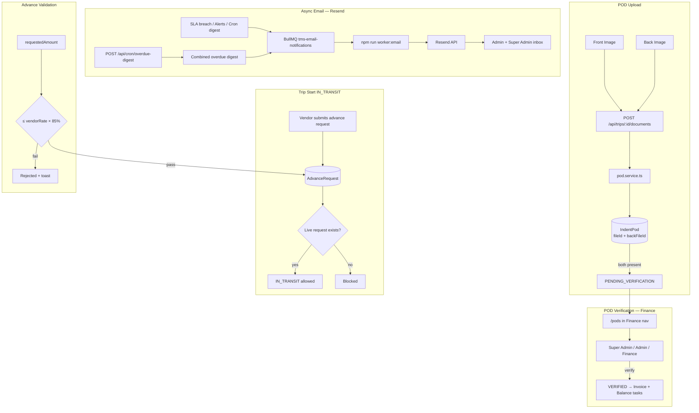

# TMS Architecture (Current)

## Overview

Transport Management System for indent → placement → trip → POD → finance workflows.

## Key domains

| Domain | Service | Notes |
|--------|---------|-------|
| POD | `pod.service.ts` | Dual image required; Finance verifies |
| Advance | `trip-advance.service.ts` | 85% vendorRate cap; request-only gate for transit |
| Email | `notify.ts`, `email/resend.ts` | BullMQ queue + worker |
| SLA | `sla-escalation.service.ts` | 24h tasks; digest via cron |

## Roles & POD access

| Role | POD upload | POD verify |
|------|------------|------------|
| Vendor / Driver | Yes | No |
| Operations | Yes | No |
| Finance | No | Yes |
| Admin / Super Admin | Yes | Yes |

## Workers & cron

| Command / endpoint | Purpose |
|--------------------|---------|
| `npm run worker:email` | Process BullMQ email jobs via Resend |
| `POST /api/cron/sla-escalate` | Escalate overdue SLA tasks |
| `POST /api/cron/overdue-digest` | Daily combined overdue email to Admin/Super Admin |
