# TMS — Architecture & User Flow

**Version:** 1.0  
**Status:** Living document  
**Last updated:** September 2026

---

## 1. System Architecture Overview

### 1.1 High-level architecture

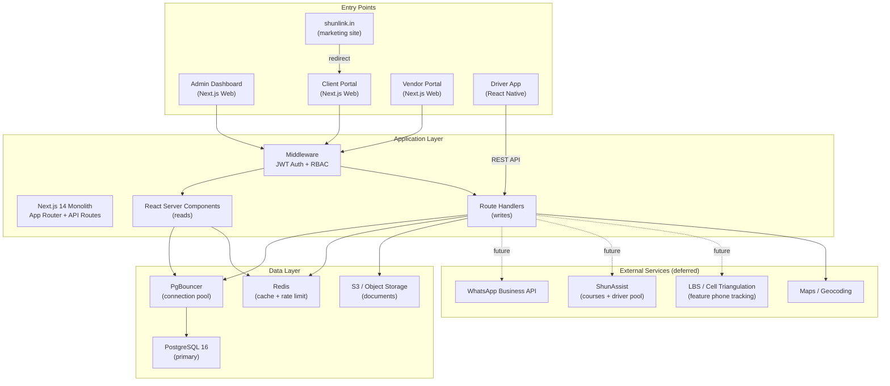

### 1.2 Request flow (stateless auth)

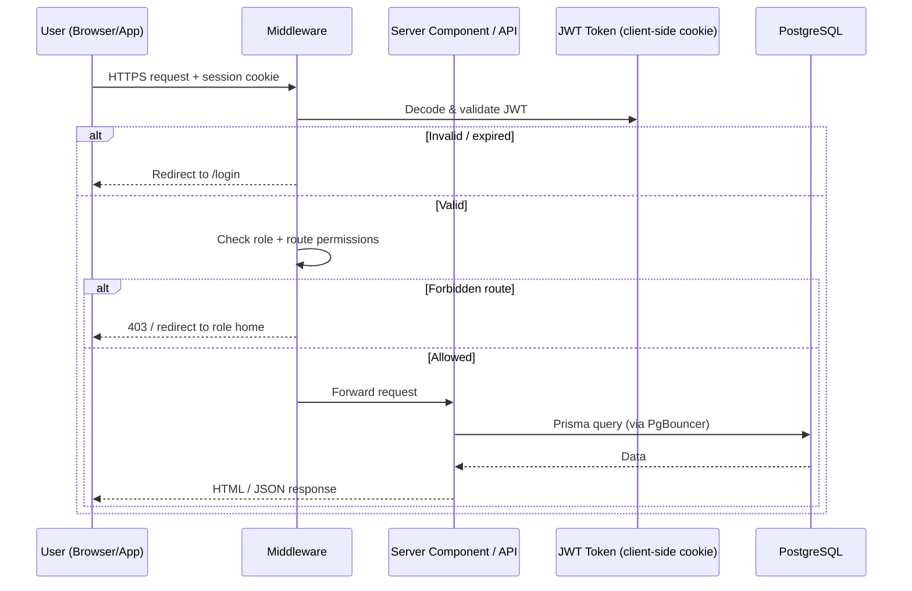

**Key design decision:** JWT tokens are stored in HTTP-only cookies on the client, not in server memory. Any app instance can validate any request — enabling horizontal scaling behind a load balancer without sticky sessions.

### 1.3 Deployment architecture

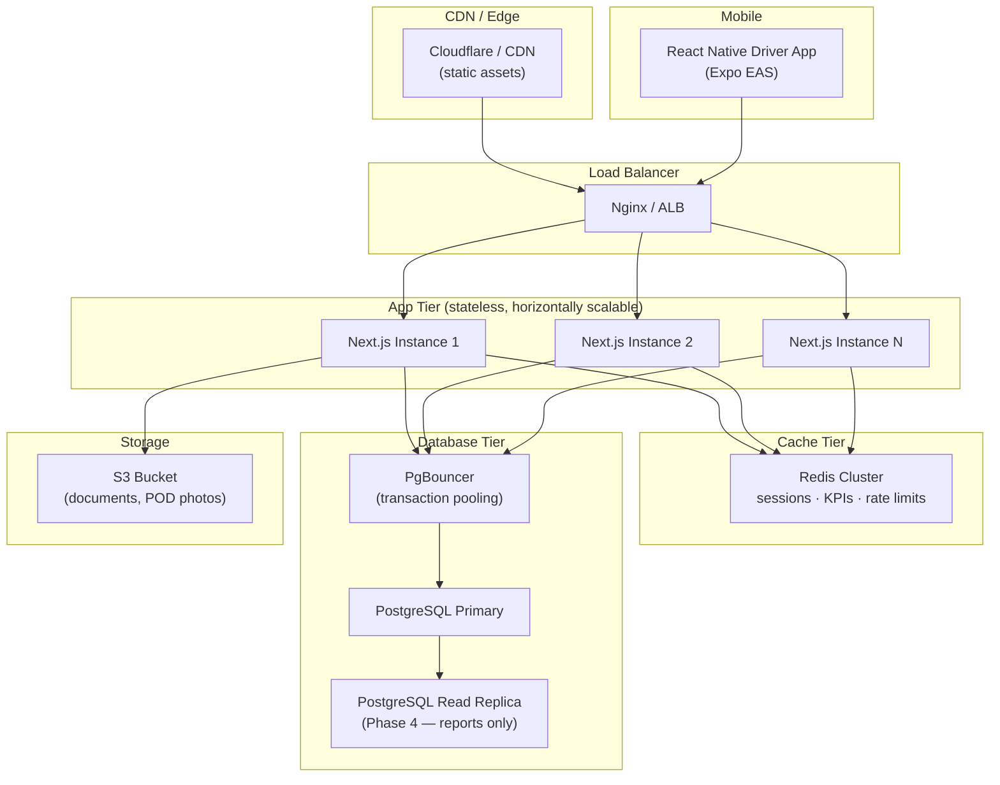

---

## 2. User Flows

### 2.1 Client journey

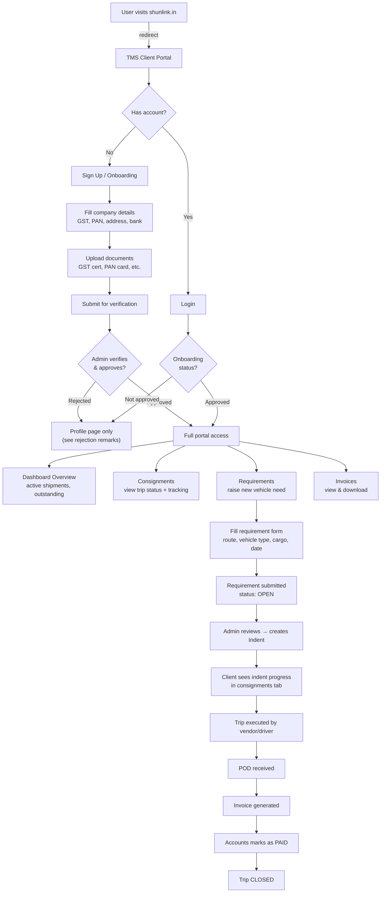

**Note:** Client requirement creation happens ~0.1% of the time. The primary path is admin creating indents directly from phone/email requests.

### 2.2 Admin journey

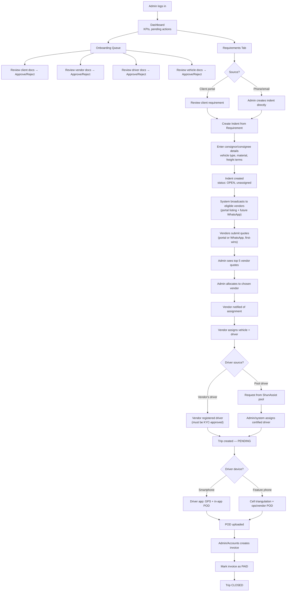

### 2.3 Vendor (transporter) journey

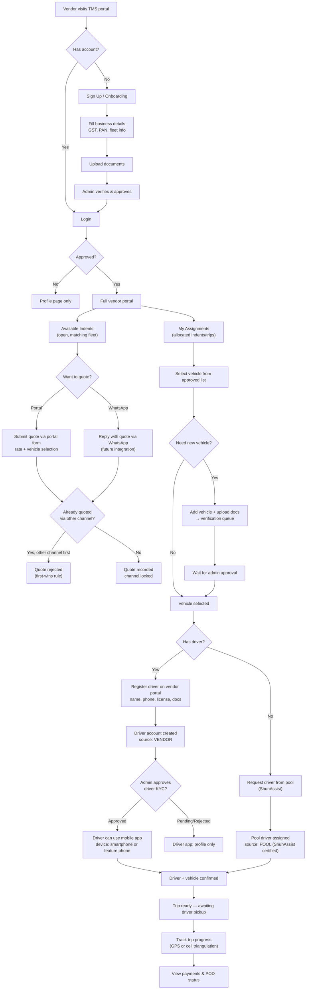

### 2.4 Driver types & onboarding paths

Every driver who operates trips must exist in the TMS driver registry. There are **three driver sources**:

| Source | How they enter the system | App access after approval |
|--------|---------------------------|---------------------------|
| **Vendor driver** | Vendor registers them on the vendor portal (details + docs) | Trip execution screens |
| **Pool driver** | Assigned from ShunAssist certified pool (vendor requests, admin assigns) | Trip execution screens |
| **Independent (newbie)** | Self-registers on the driver app (not linked to a vendor) | Subscription / course screens only (until certified) |

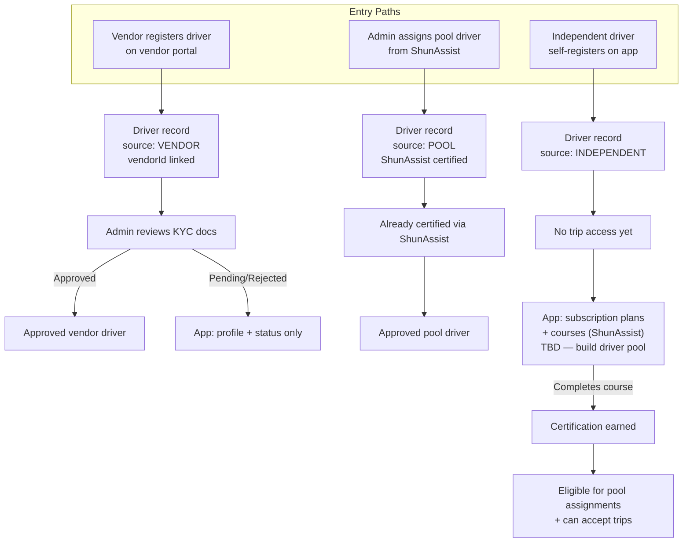

### 2.5 Driver app experience (React Native)

The driver app is **one app for all drivers**, but the home screen depends on **source + approval/certification status**:

```mermaid
flowchart TD
    A["Driver opens app"] --> B["Login / Sign up"]
    B --> C{"Driver source<br/>+ status?"}

    C -->|VENDOR driver<br/>not approved| D["Profile + KYC status<br/>'Awaiting verification'"]
    C -->|INDEPENDENT<br/>not certified| E["Subscription & courses<br/>(ShunAssist integration TBD)"]
    C -->|VENDOR or POOL<br/>approved/certified| F["Home — assigned trips"]

    E --> E1["Browse plans / enroll in course"]
    E1 --> E2["Complete certification"]
    E2 --> F

    F --> G{"Device type?"}
    G -->|Smartphone| H["Full trip flow<br/>GPS + camera POD"]
    G -->|Feature phone (keypad)| I["Limited trip flow<br/>USSD/SMS or ops-assisted<br/>cell triangulation tracking"]

    H --> J["Select trip → arrive at pickup → start trip"]
    J --> K["GPS pings every 2-4 hours"]
    K --> L["Arrive at destination → upload POD photo"]
    L --> M["Trip → POD_RECEIVED"]

    I --> N["Trip assigned — tracking via<br/>cell tower triangulation"]
    N --> O["Periodic location from<br/>mobile network (no app GPS)"]
    O --> P["POD via vendor/ops upload<br/>or SMS photo link (TBD)"]
    P --> M
```

**App screen matrix:**

| Screen | Vendor driver (approved) | Pool driver | Independent (uncertified) | Any (pending KYC) |
|--------|--------------------------|-------------|---------------------------|-------------------|
| Login / Sign up | ✅ | ✅ | ✅ | ✅ |
| Profile & documents | ✅ | ✅ | ✅ | ✅ |
| Assigned trips | ✅ | ✅ | ❌ | ❌ |
| Trip execution (start/end) | ✅ | ✅ | ❌ | ❌ |
| GPS location sharing | ✅ (smartphone) | ✅ | ❌ | ❌ |
| POD camera upload | ✅ (smartphone) | ✅ | ❌ | ❌ |
| Subscription plans | ❌ | ❌ | ✅ (TBD) | ❌ |
| Courses / certification | ❌ | Optional refresh | ✅ (ShunAssist) | ❌ |
| KYC pending message | — | — | — | ✅ |

### 2.6 Location tracking — dual mode

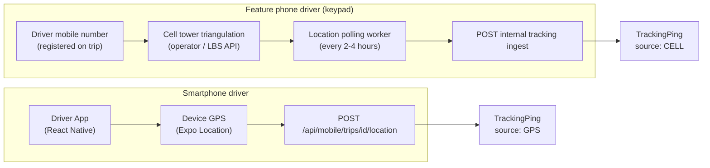

| Mode | Device | How location is captured | POD upload |
|------|--------|--------------------------|------------|
| **GPS (primary)** | Smartphone with driver app | App background GPS → `TrackingPing` | In-app camera |
| **Cell triangulation (fallback)** | Keypad / feature phone, no smartphone | Mobile number + LBS/triangulation API on schedule | Vendor uploads on behalf, or ops-assisted (TBD) |

**Note:** Cell triangulation accuracy is lower than GPS (typically 500m–2km vs 5–20m). Acceptable for corridor-level tracking on long-haul lanes; document this limitation for ops team.

### 2.7 End-to-end order lifecycle

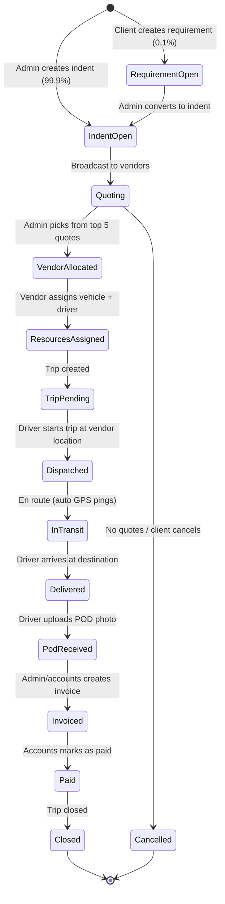

---

## 3. Data Flow Architecture

### 3.1 Read path (server components)

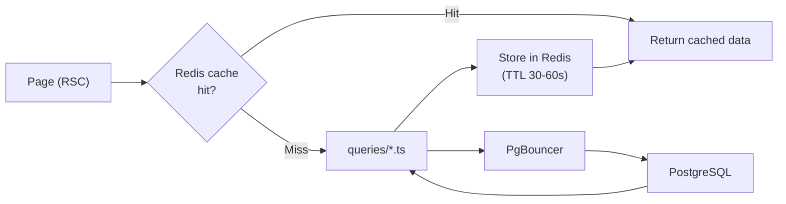

### 3.2 Write path (API routes)

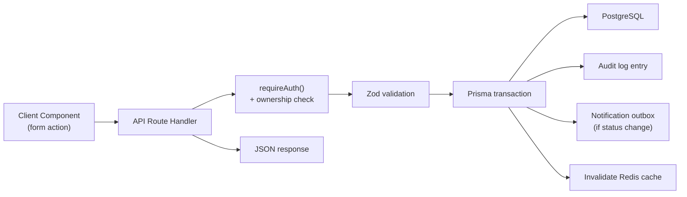

### 3.3 Vendor quote flow (first-wins)

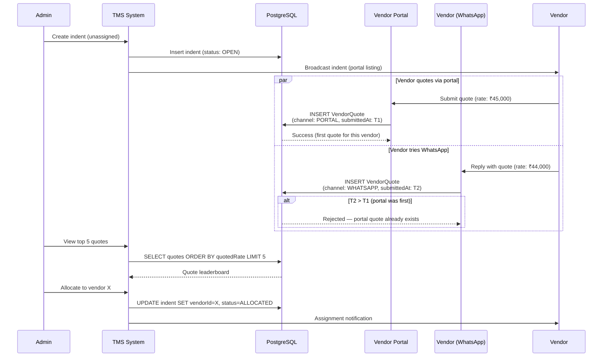

---

## 4. Component Architecture (Application Internals)

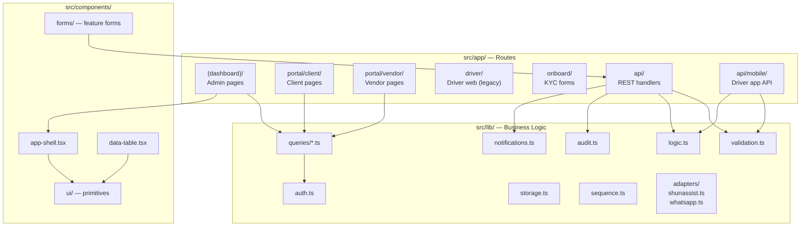

---

## 5. Authentication & Authorization Model

### 5.1 Role hierarchy

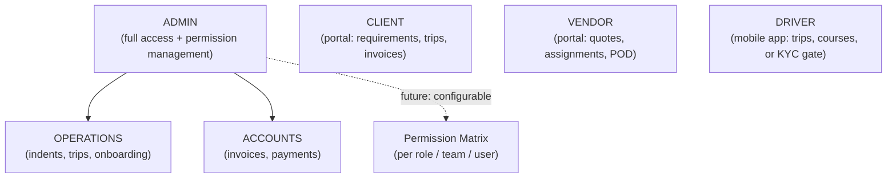

### 5.2 Onboarding gate

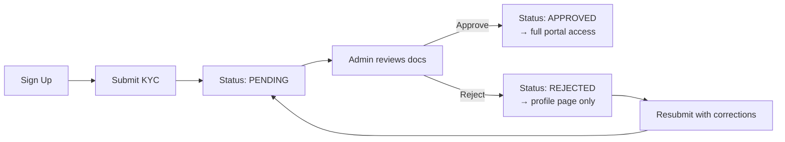

Applies to: Client, Vendor, Vehicle (verification). **Drivers** use the same KYC gate for vendor-registered drivers; independent drivers use the **certification gate** (ShunAssist courses) instead.

---

## 6. Integration Architecture

### 6.1 ShunAssist — driver pool & certification (adapter pattern)

ShunAssist serves **two purposes** in the driver ecosystem:

1. **Certification** — independent ("newbie") drivers complete courses on ShunAssist to join the certified pool
2. **Pool supply** — vendors request certified drivers; TMS assigns from the pool

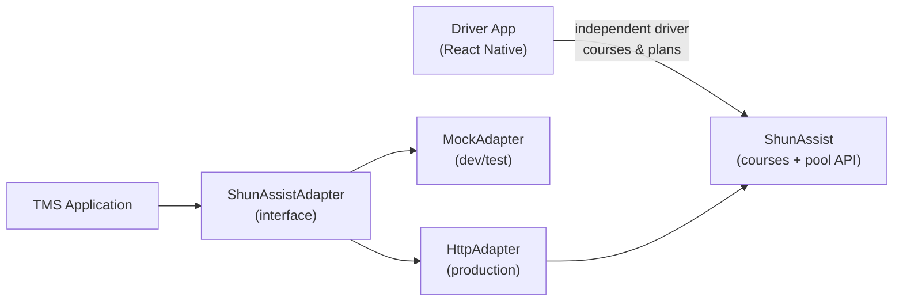

**Contract (planned):**
- `listAvailableDrivers(location, vehicleType)` → certified drivers near pickup
- `assignDriver(driverId, indentId)` → reserve driver for trip
- `releaseDriver(driverId)` → return driver to pool after trip
- `getCertificationStatus(driverId)` → course completion / pool eligibility
- `listSubscriptionPlans()` → plans shown to uncertified independent drivers (TBD)
- `enrollDriver(driverId, planId)` → start certification path (TBD)

### 6.2 Cell tower triangulation (feature phone tracking)

For drivers on **keypad/feature phones** without the smartphone app:

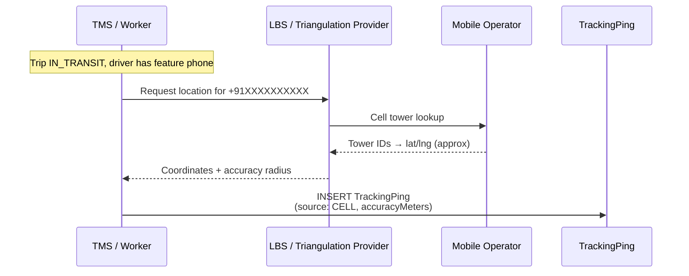

**Provider options (India):** operator LBS APIs, third-party telco-location services, or SIM-based tracking partners. Selection TBD in Phase 2.

**Requirements:**
- Driver phone number must be registered on the trip and match operator records
- Polling interval: same as GPS mode (every 2–4 hours while `IN_TRANSIT`)
- Store `accuracyMeters` on each ping so ops can distinguish GPS vs cell data
- POD for feature-phone drivers: vendor portal upload or ops-assisted capture (workflow TBD)

### 6.3 WhatsApp integration (deferred — adapter ready)

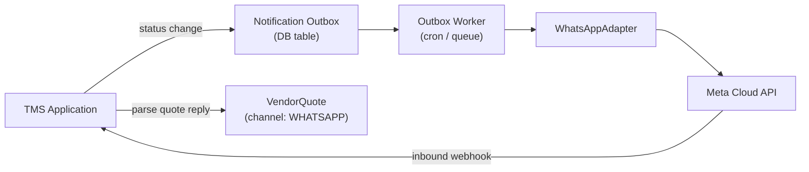

### 6.4 Document storage

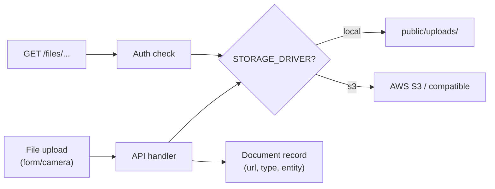

---

## 7. Security Architecture

| Layer | Mechanism |
|-------|-----------|
| Transport | HTTPS everywhere (TLS 1.2+) |
| Authentication | NextAuth JWT (HTTP-only cookie) + bcrypt passwords |
| Mobile auth | Short-lived access token (15min) + refresh token (7d) in Redis |
| Authorization | Middleware role routing + API allowlist + handler-level ownership checks |
| Future RBAC | Permission matrix per role/team/user (Phase 3) |
| Rate limiting | Redis-backed (login: 8 attempts / 5 min) |
| Input validation | Zod schemas on all API inputs |
| File uploads | Type/size limits, authenticated access only |
| Audit | All mutations logged to AuditLog table |
| Headers | X-Frame-Options, X-Content-Type-Options, Referrer-Policy (next.config.js) |

---

## 8. Technology Decisions Summary

| Decision | Choice | Rationale |
|----------|--------|-----------|
| App architecture | Next.js monolith | Single deployable unit; RSC for fast reads; sufficient for 500+ trips/day |
| Database | PostgreSQL 16 + PgBouncer | ACID for financial data; connection pooling for scale |
| Cache | Redis | Dashboard KPIs, rate limits, mobile refresh tokens |
| Auth | JWT (stateless) | Horizontal scaling without sticky sessions |
| Driver app | React Native (Expo) | Native camera/GPS; cross-platform; faster than Flutter for JS team |
| File storage | S3 (production) | Scalable, durable; local for dev |
| ORM | Prisma | Type-safe; migration management; team familiarity |
| Notifications | Outbox pattern | Reliable delivery; decouple from request cycle |
| Sharding | Not now | Single Postgres + pooling handles target scale (see SCHEMA doc) |
