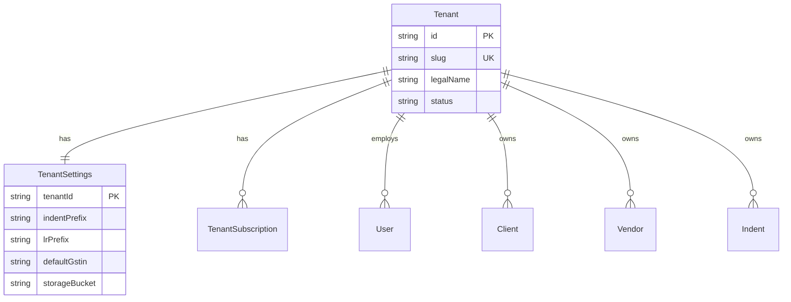
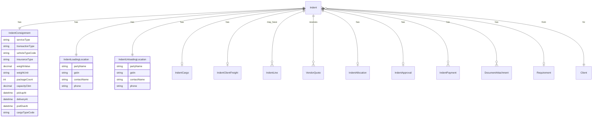
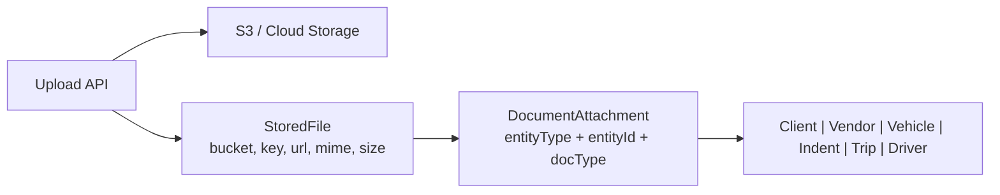

# TMS — SaaS Database Schema Design

**Version:** 2.0 (production redesign)  
**Status:** Draft — pending your answers on open questions  
**Prisma file:** `prisma/schema.saas.prisma`  
**SaaS product guide:** [SAAS_PLATFORM_GUIDE.md](./SAAS_PLATFORM_GUIDE.md) (architecture, auth, workflows, plans)

---

## 1. Design goals

| Goal | Approach |
|------|----------|
| **SaaS / multi-tenant** | Every business row scoped by `tenantId`; unique numbers per tenant |
| **Normalized indent** | Split wide `Indent` table into consignment, locations, cargo, freight, quotes, allocation, workflow |
| **Reusable primitives** | `Address`, `BankAccount`, `StoredFile`, `OnboardingCase` shared across entities |
| **Cloud documents** | Files stored in S3 (or compatible); DB holds metadata + URL/key only |
| **Audit & compliance** | Financial and status changes traceable; soft-delete on masters |
| **Scale** | Indexes on `tenantId` + hot filters; no JSON blobs for critical business fields |

---

## 2. SaaS tenancy model



**Isolation rules:**
- `User.email` is unique **per tenant**: `@@unique([tenantId, email])`
- Document numbers (`indentNumber`, `lrNumber`, `invoiceNumber`) unique **per tenant**
- All API queries **must** filter by `tenantId` from JWT/session (never trust client input alone)
- Portal users (CLIENT/VENDOR/DRIVER) belong to the same tenant as their organization

**Shunlink** = first tenant (`slug: shunlink`). Other 3PL companies onboard as new tenants with isolated data.

---

## 3. Schema layers (module map)

```
┌─────────────────────────────────────────────────────────────┐
│  PLATFORM: Tenant, TenantSettings, TenantSubscription       │
├─────────────────────────────────────────────────────────────┤
│  AUTH/RBAC: User, Permission, RolePermission, UserPerm      │
├─────────────────────────────────────────────────────────────┤
│  PRIMITIVES: Address, BankAccount, StoredFile, OnboardingCase│
├─────────────────────────────────────────────────────────────┤
│  MASTERS: Client*, Vendor*, Driver, Vehicle*                │
│           (* = core + addresses + bank + commercial)        │
├─────────────────────────────────────────────────────────────┤
│  COMMERCIAL: Requirement → Indent* → Trip → Invoice/Payment │
│              (* = normalized indent cluster)                  │
├─────────────────────────────────────────────────────────────┤
│  MARKETPLACE: VendorQuote, IndentAllocation                 │
├─────────────────────────────────────────────────────────────┤
│  EXECUTION: TrackingPing, Notification                      │
├─────────────────────────────────────────────────────────────┤
│  SYSTEM: AuditLog, IdSequence, LookupCatalog               │
└─────────────────────────────────────────────────────────────┘
```

---

## 4. Indent cluster (normalized)

The old `Indent` table had **50+ columns**. The new design splits it as follows:



### 4.1 Field mapping (your form → tables)

| UI field | Table.column |
|----------|----------------|
| Service Type * (GTA) | `IndentConsignment.serviceType` |
| GSTIN (consignor) | `IndentLoadingLocation.gstin` (not on consignment block) |
| Client GSTIN | `Client.gstin` (master) |
| Veh. Type * | `IndentConsignment.vehicleTypeCode` → `LookupCatalog` |
| Transaction Type * (Spot) | `IndentConsignment.transactionType` |
| Pickup Date * | `IndentConsignment.pickupAt` |
| Insurance Type * | `IndentConsignment.insuranceType` |
| Weight (MT) * | `IndentConsignment.weightValue` + `weightUnit` |
| No Of Packages | `IndentConsignment.packageCount` |
| Capacity (Cubic Meters) | `IndentConsignment.capacityCbm` |
| Delivery On * | `IndentConsignment.deliveryAt` |
| POD On | `IndentConsignment.podDueAt` |
| Cargo Type * | `IndentConsignment.cargoTypeCode` → `CargoTypeCatalog` |
| Consignor / loading location | `IndentLoadingLocation` + `Address` |
| Consignee / unloading location | `IndentUnloadingLocation` + `Address` |
| Client rate / freight terms | `IndentClientFreight` |
| Vendor quotes | `VendorQuote` |
| Winning vendor + rate | `IndentAllocation` |

### 4.2 Multi-vehicle indents (`quantity > 1`)

`IndentConsignment.vehicleQuantity` = how many trucks needed.

Each physical truck becomes an **`IndentLine`** (line 1..N), each with its own:
- `VendorQuote` acceptance
- `IndentAllocation` (vendor, vehicle, driver)
- `Trip` (LR execution)

If you always allocate one vendor for all trucks on an indent, lines still help tracking per vehicle.

---

## 5. Document storage



- **Never** store file bytes in Postgres
- `StoredFile.url` = CDN URL or pre-signed URL pattern
- `StoredFile.storageKey` = object key for deletion/rotation
- `DocumentAttachment.documentType` = `GST_CERT`, `PAN`, `RC`, `POD`, `EWAY_BILL`, `LR`, etc.

---

## 6. Entity relationship (full)

See Mermaid diagram in Section 4 and the Prisma file for all relations.

**Core flows:**
```
Requirement (client, rare) ──► Indent ──► VendorQuote[] ──► IndentAllocation ──► Trip ──► ClientInvoice
Client master ◄────────────────────────────────────────────────────────────────────────────────────┘
Vendor master ◄── VendorQuote / IndentAllocation / VendorPayment
Driver / Vehicle ◄── IndentAllocation / Trip
```

---

## 7. Migration from v1 schema

| v1 model | v2 destination |
|----------|----------------|
| `Indent` (wide) | `Indent` + `IndentConsignment` + locations + cargo + freight |
| `Document` (polymorphic FKs) | `StoredFile` + `DocumentAttachment` |
| `Client` (wide) | `Client` + `ClientAddress` + `ClientCommercial` + `OnboardingCase` |
| `Vendor` (wide) | `Vendor` + `VendorAddress` + `VendorCommercial` + `OnboardingCase` |
| `User` | `User` + `tenantId` |
| — | New: `Tenant`, `TenantSettings` |

**Strategy:** Blue/green migration script that reads v1 rows and inserts normalized v2 rows per tenant (default tenant = Shunlink).

---

## 8. Confirmed decisions

| Topic | Decision |
|-------|----------|
| Multi-truck indent | **3 trucks = 3 `IndentLine` rows → 3 separate LRs/trips** |
| Consignment GSTIN | **Not stored on consignment block** — use client master GSTIN and consignor GSTIN on loading location only |
| POD On date | **`podDueAt` = deadline for driver POD upload** |
| SaaS tenant onboarding | **Manual provisioning now**; schema supports self-serve signup later |
| Vendor quotes | All quotes in `VendorQuote`; winner rate on `IndentAllocation.vendorRate` |

### Still open (optional — reply anytime)

1. **Transaction types:** Besides `SPOT`, need `CONTRACT`, `DEDICATED`, etc.?
2. **Cargo types:** Fixed catalog (FMCG, Steel, …) or tenant-defined only?
3. **Cross-tenant users:** Same email on multiple tenants OK? *(current: yes, separate user row per tenant)*

---

## 9. Model inventory (42 tables)

| Layer | Models | Count |
|-------|--------|------:|
| SaaS platform | `Tenant`, `TenantSettings`, `TenantSubscription` | 3 |
| Auth / RBAC | `User`, `Permission`, `RolePermission`, `UserPermission` | 4 |
| Primitives | `Address`, `BankAccount`, `OnboardingCase`, `StoredFile`, `DocumentAttachment` | 5 |
| Lookups | `LookupCatalog` | 1 |
| Client | `Client`, `ClientAddress`, `ClientCommercial` | 3 |
| Vendor | `Vendor`, `VendorAddress`, `VendorCommercial` | 3 |
| Fleet | `Driver`, `Vehicle`, `VehicleCompliance`, `VehicleTelematics` | 4 |
| Commercial flow | `Requirement`, `Indent`, `IndentConsignment`, `IndentLoadingLocation`, `IndentUnloadingLocation`, `IndentCargo`, `IndentClientFreight`, `IndentLine`, `VendorQuote`, `IndentAllocation`, `IndentApproval`, `IndentPayment` | 12 |
| Execution | `Trip`, `TrackingPing` | 2 |
| Finance | `ClientInvoice`, `ClientInvoiceLine`, `VendorPayment`, `Advance` | 4 |
| System | `Notification`, `AuditLog`, `IdSequence` | 3 |

**Prisma file:** `prisma/schema.saas.prisma` (validated ✅)

### Default lookup seed (system `tenantId = null`)

| category | code | label |
|----------|------|-------|
| SERVICE_TYPE | GTA | Goods Transport Agency |
| TRANSACTION_TYPE | SPOT | Spot booking |
| TRANSACTION_TYPE | CONTRACT | Contract lane |
| INSURANCE_TYPE | NONE | No insurance |
| INSURANCE_TYPE | TRANSIT | Transit insurance |
| WEIGHT_UNIT | MT | Metric tonnes |
| WEIGHT_UNIT | KG | Kilograms |

Cargo types and vehicle types seeded per tenant on onboarding.

---

## 10. Next steps

1. You answer open questions (Section 8)
2. Lock enums / lookup seed data per tenant
3. Swap `schema.prisma` → `schema.saas.prisma` after sign-off
4. Generate migration: `npx prisma migrate dev --schema=prisma/schema.saas.prisma`
5. Build v1 → v2 data migration script (default tenant: `shunlink`)
6. Update API/validation to read/write normalized indent cluster
