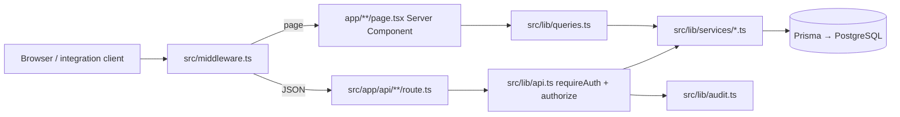

# TMS — Developer Codemap

**Purpose:** Onboarding guide for engineers editing this repo. Maps **routes**, **API handlers**, and **services** to responsibilities so you can find the right file quickly.

**Last updated:** October 2026  
**Companion docs:** [ARCHITECTURE_AND_USER_FLOW.md](./ARCHITECTURE_AND_USER_FLOW.md) (journeys), [ARCHITECTURE.md](./ARCHITECTURE.md) (POD/advance/email), [bidding-integration.md](./bidding-integration.md), [PAYMENT_PROCESSING.md](./PAYMENT_PROCESSING.md), [accounting-foundation.md](./accounting-foundation.md), [DATABASE_SCHEMA.md](./DATABASE_SCHEMA.md)

---

## 1. How a request is handled



| Layer | Location | Role |
|--------|-----------|------|
| **Edge auth & role routing** | `src/middleware.ts` | NextAuth JWT; redirects by role; API allowlist for CLIENT/VENDOR/DRIVER |
| **Session** | `src/lib/auth.ts`, `src/app/api/auth/[...nextauth]/route.ts` | Credentials login (email/password, driver DL+OTP) |
| **Auth context in APIs** | `src/lib/auth-context.ts`, `src/lib/api.ts` | `requireAuth()`, `authorize(permission)`, JSON helpers |
| **Read models for UI** | `src/lib/queries.ts` | Server-side reads for dashboards and portals (uses services + Prisma) |
| **Writes & rules** | `src/lib/services/*.ts` | Business logic, transactions, state machines |
| **Validation** | `src/lib/validation.ts` | Zod schemas shared by forms and APIs |
| **Permissions** | `src/lib/services/permission.service.ts`, `src/lib/nav-permissions.ts` | RBAC keys + sidebar mapping |

**Convention:** Pages should stay thin; **mutations go through API routes** that call **services**. Pages call `queries.ts` for data.

---

## 2. Repository layout

```
src/
  app/                    # Next.js App Router
    (dashboard)/          # Internal staff UI (ADMIN, OPERATIONS, FINANCE, …)
    portal/client/        # Client portal
    portal/vendor/        # Vendor portal
    driver/               # Driver web UI (OTP login)
    onboard/              # Client/vendor KYC wizards (pre-approval)
    login/, signup/, welcome/
    superadmin/           # SUPER_ADMIN only
    api/                  # REST route handlers
  components/             # React UI (forms/, portal/, ui/, shells)
  hooks/                  # Client hooks (e.g. sidebar pending counts)
  lib/
    services/             # Domain services (primary place for business logic)
    accounting/           # GL, journals, reconciliation
    payments/             # Gateway, outbound payments, reconciliation
    integration/bidding/  # Bidding ↔ TMS server integration
    integrations/         # GST, DL, vehicle, e-way bill providers
    superadmin/           # Portal access impersonation, master OTP
    queries.ts            # Read layer for RSC pages
    prisma.ts             # Prisma client
prisma/                   # Schema + migrations + seed
scripts/                  # Workers (email, payment), tooling
docs/                     # Architecture and domain docs
```

---

## 3. Roles and where users land

| Role | Home route | Defined in |
|------|------------|------------|
| `SUPER_ADMIN`, `ADMIN`, `SALES`, `OPERATIONS`, `FINANCE`, `VENDOR_TEAM` | `/` (dashboard) | `src/lib/auth-home.ts`, `(dashboard)/layout.tsx` |
| `CLIENT` | `/portal/client` (after onboarding) | `src/lib/portal-access.ts` |
| `VENDOR` | `/portal/vendor` | `src/lib/portal-access.ts` |
| `DRIVER` | `/driver` | `src/middleware.ts` |

**Onboarding gate (client/vendor):** `PENDING` / missing → `/onboard/*`; `SUBMITTED` or `REJECTED` → profile-only portal; `APPROVED` → full portal. See `src/lib/portal-access.ts` and portal layouts under `src/app/portal/*/layout.tsx`.

**Super Admin “portal access”:** Impersonate client/vendor for support — `src/lib/superadmin/portal-access-session.service.ts`, UI banner `src/components/superadmin/portal-access-banner.tsx`, routes under `src/app/superadmin/portal-access/` and `src/app/api/superadmin/portal-access/*`.

---

## 4. UI routes (pages)

### 4.1 Public / auth

| Path | File | Notes |
|------|------|--------|
| `/welcome` | `src/app/welcome/page.tsx` | Portal picker; `?role=client|vendor` → signup |
| `/login` | `src/app/login/page.tsx` | Unified hub (employee / client / transporter tabs) |
| `/login/employee`, `/login/client`, `/login/vendor`, `/login/driver` | `src/app/login/*/page.tsx` | Role-branded login |
| `/signup`, `/signup/client`, `/signup/vendor` | `src/app/signup/**` | Registration |
| `/onboard/client`, `/onboard/vendor` | `src/app/onboard/**` | KYC wizard (`src/components/onboarding/*`, forms in `src/components/forms/onboarding-*`) |

### 4.2 Client portal (`CLIENT`)

| Path | File |
|------|------|
| `/portal/client` | `src/app/portal/client/page.tsx` |
| `/portal/client/requirements`, `.../new` | `requirements/page.tsx`, `requirements/new/page.tsx` |
| `/portal/client/trips` | `trips/page.tsx` (UI label: Shipments) |
| `/portal/client/invoices`, `.../[id]` | `invoices/*` |
| `/portal/client/profile` | `profile/page.tsx` |
| Layout / shell | `layout.tsx`, `src/components/client-portal-shell.tsx` |

### 4.3 Vendor portal (`VENDOR`)

| Path | File |
|------|------|
| `/portal/vendor` | `page.tsx` |
| `/portal/vendor/indents` | Open indents / quoting |
| `/portal/vendor/trips`, `.../[id]` | Assigned trips |
| `/portal/vendor/assignments/[id]` | Placement / assignment detail |
| `/portal/vendor/payments` | Payment summary |
| `/portal/vendor/advances/[id]/voucher` | Advance voucher print view |
| `/portal/vendor/profile` | `profile/page.tsx` |
| Layout / shell | `layout.tsx`, `src/components/vendor-portal-shell.tsx` |

### 4.4 Driver web (`DRIVER`)

| Path | File |
|------|------|
| `/driver` | Current trip + tracking (`src/components/forms/driver-tracking.tsx`) |
| `/driver/profile` | `profile/page.tsx` |
| Layout | `src/app/driver/layout.tsx` |

### 4.5 Internal dashboard (`(dashboard)`)

Navigation is driven by **permissions** and **team** — see `src/lib/nav-permissions.ts` (`NAV_GROUPS`, `TEAM_NAV_HREFS`).

| Area | Example paths | Typical permissions |
|------|----------------|---------------------|
| Overview | `/` | `dashboard.view` |
| Operations | `/indents`, `/indents/board`, `/placement`, `/onboarding`, `/requirements`, `/trips`, `/trips/board` | `indent.view`, `placement.view`, `trip.view`, … |
| Partners | `/clients`, `/vendors`, `/vehicles`, `/drivers` | `client.view`, `vendor.view`, … |
| Finance | `/invoices`, `/receivables`, `/payables`, `/client-payments`, `/payments`, `/pods`, `/financial-notes`, `/accounting/*` | `invoice.view`, `payment.view`, `pod.view`, `accounting.*` |
| Admin | `/users`, `/permissions`, `/audit`, `/bidding-management`, `/settings` | `users.manage`, `permissions.manage`, … |

Detail pages follow `[id]` / `new` patterns under each folder (e.g. `src/app/(dashboard)/indents/[id]/page.tsx`).

### 4.6 Super Admin

| Path | File |
|------|------|
| `/superadmin/portal-access` | `src/app/superadmin/portal-access/page.tsx` |

---

## 5. API routes (by domain)

There are **162** route handlers under `src/app/api/**/route.ts` (grouped below by domain, not a full path list).

Middleware **excludes** from auth: `api/auth`, `api/health`, `api/webhooks`, `api/webhook`, `api/integration/bidding`, `api/drivers/otp`, public login/signup/welcome (see `config.matcher` in `src/middleware.ts`).

Portal roles have a **narrow API allowlist** in middleware; internal roles use permission checks inside handlers.

### 5.1 Auth & users

| Route | Handler | Service / notes |
|-------|---------|-----------------|
| `POST /api/auth/signup` | `api/auth/signup/route.ts` | `signup.service.ts` |
| `POST /api/auth/forgot-password`, `reset-password` | `api/auth/*` | `password-reset.service.ts` |
| `GET/POST /api/users`, `.../[id]` | `api/users/*` | `employee.service.ts` |
| `GET/POST /api/permissions` | `api/permissions/route.ts` | `permission.service.ts` |
| `GET/POST /api/teams` | `api/teams/route.ts` | Team assignment |

### 5.2 Portal (client & vendor self-service)

| Route | Handler | Service / notes |
|-------|---------|-----------------|
| `GET/PATCH /api/portal/profile` | `api/portal/profile/route.ts` | `profile.service.ts` |
| `GET/POST /api/portal/documents` | `api/portal/documents/route.ts` | `document.service.ts` |
| `POST /api/portal/onboarding` | `api/portal/onboarding/route.ts` | `onboarding.service.ts` |
| `GET /api/portal/vendor/open-indents` | `api/portal/vendor/open-indents/route.ts` | Vendor indent listing |
| `POST /api/portal/vendor/trips/[id]/advance` | advance route | `trip-advance.service.ts` |

### 5.3 Operations — requirements, indents, trips

| Route | Handler | Service / notes |
|-------|---------|-----------------|
| `GET/POST /api/requirements`, `.../[id]` | `api/requirements/*` | Client requirements |
| `GET/POST/PATCH /api/indents`, `.../[id]` | `api/indents/*` | `indent.service.ts` |
| `POST /api/indents/[id]/allocate` | allocate route | `allocation.service.ts` |
| `GET/POST /api/indents/[id]/quotes` | quotes route | `quote.service.ts` (first-wins channel lock) |
| `POST /api/indents/[id]/create-trip` | create-trip | `trip-from-indent.service.ts` |
| `PATCH /api/indents/[id]/vehicle`, `.../driver` | placement fields | `indent.service.ts`, driver/vehicle assignment |
| `GET/POST /api/placement` | `api/placement/route.ts` | `placement.service.ts` |
| `GET/POST/PATCH /api/trips`, `.../[id]` | `api/trips/*` | Trip lifecycle |
| `POST /api/trips/[id]/documents` | documents | `pod.service.ts` (POD images) |
| `POST /api/trips/[id]/tracking` | tracking | `tracking.service.ts` |
| `GET /api/finance/trips/[tripId]` | finance trip API | `trip-finance.service.ts` |

### 5.4 Partners — clients, vendors, vehicles, drivers

| Route | Handler | Service / notes |
|-------|---------|-----------------|
| `GET/POST/PATCH /api/clients`, `.../[id]` | `api/clients/*` | Client CRUD |
| `GET/POST/PATCH /api/vendors`, `.../[id]` | `api/vendors/*` | Vendor CRUD, beneficiaries |
| `GET/POST/PATCH /api/vehicles`, `.../[id]` | `api/vehicles/*` | `vehicle.service.ts` |
| `GET/POST/PATCH /api/drivers`, `.../[id]` | `api/drivers/*` | `driver.service.ts` |
| `POST /api/drivers/otp/request` | public OTP | `otp.service.ts` |
| `GET /api/drivers/me/current-indent` | driver session | Used by `/driver` |
| `GET/POST /api/onboarding/[type]/[id]` | staff onboarding review | `onboarding.service.ts` |

### 5.5 Finance — invoices, payables, advances, POD

| Route | Handler | Service / notes |
|-------|---------|-----------------|
| `GET/POST /api/invoices`, `.../[id]` | `api/invoices/*` | `invoice.service.ts` |
| `GET/POST /api/client-payments`, `.../[id]` | client payments | `client-payment.service.ts` |
| `GET /api/payables` | payables list | `payables.service.ts` |
| `GET/POST /api/payments`, `.../[id]` | vendor payments | `vendor-payment.service.ts` |
| `GET/POST /api/advance-requests`, `.../[id]` | advances | `trip-advance.service.ts`, `advance.service.ts` |
| `GET/POST /api/balance-payments`, `.../[id]` | balance payouts | `vendor-balance-payment.service.ts` |
| `GET/POST /api/outbound-payments`, `.../execute` | gateway payouts | `src/lib/payments/*` |
| `POST /api/pods/[id]/review` | POD verify/reject | `pod.service.ts` |
| `GET/POST /api/financial-notes`, `.../approve` | debit/credit notes | `financial-note.service.ts` |
| `GET/POST /api/invoice-tasks` | post-POD tasks | `invoice-task.service.ts` |

### 5.6 Accounting

Handlers under `src/app/api/accounting/**` delegate to `src/lib/accounting/*` (chart of accounts, journals, periods, reports, bank reconciliation, subledgers, gateway settlement import).

### 5.7 Integrations

| Route prefix | Doc | Code |
|--------------|-----|------|
| `/api/integration/bidding/*` | [bidding-integration.md](./bidding-integration.md) | `bidding-integration.service.ts`, `src/lib/integration/bidding/*` |
| `/api/bidding-proxy/[...path]` | Admin UI proxy to Bidding app | `src/lib/integration/bidding/proxy.ts` |
| `/api/integrations/gst|dl|vehicle|ewaybill/*` | Provider verification | `src/lib/integrations/**` |
| `/api/webhooks/whatsapp/*` | Inbound quotes / messages | `whatsapp-quote-session.service.ts` |
| `/api/webhooks/payments` | Payment gateway callbacks | `src/lib/payments/*` |

### 5.8 Platform

| Route | Purpose |
|-------|---------|
| `GET /api/dashboard` | Dashboard KPIs |
| `GET /api/sidebar/pending-counts` | Badge counts for nav |
| `GET /api/export/[entity]` | CSV/export |
| `POST /api/cron/overdue-digest`, `sla-escalate` | Scheduled jobs (protect in production) |
| `GET /api/geocode` | Geocoding helper |
| `GET/POST /api/notifications/*` | In-app notifications |
| `GET/POST /api/important-events` | SLA / escalation events |
| `POST /api/superadmin/*` | Portal access, master OTP |

For any route, open the matching `route.ts` — it lists the imported service functions.

---

## 6. Services catalog (`src/lib/services/`)

| Service file | Responsibility |
|--------------|----------------|
| `indent.service.ts` | Indent CRUD, lifecycle, e-way bill fields, list/detail mappers |
| `allocation.service.ts` | Vendor allocate / reallocate, allocation modes |
| `quote.service.ts` | Vendor quotes (portal/WhatsApp), first-wins per vendor |
| `placement.service.ts` | Post-allocation vehicle placement queue |
| `trip-from-indent.service.ts` | Create trip from indent |
| `tracking.service.ts` | Trip/indent tracking pings |
| `pod.service.ts` | POD upload (front/back), finance verification workflow |
| `onboarding.service.ts` | Client/vendor/driver KYC submit & admin review queue |
| `signup.service.ts` | Self-service registration |
| `profile.service.ts` | Portal profile updates |
| `document.service.ts` | Document metadata + storage integration |
| `driver.service.ts` | Driver registry & updates |
| `vehicle.service.ts` | Vehicle registry & verification |
| `employee.service.ts` | Internal user management |
| `permission.service.ts` | Role permission grants |
| `invoice.service.ts` | Client invoicing |
| `invoice-task.service.ts` | Tasks after POD verification |
| `client-payment.service.ts` | Client receipt recording |
| `payables.service.ts` | Vendor payable listing & filters |
| `authoritative-vendor-payable.service.ts` | Source of truth for trip vendor balances |
| `vendor-payment.service.ts` | Vendor payment processing |
| `vendor-balance-payment.service.ts` | Balance payment tasks after POD |
| `trip-advance.service.ts` | Advance requests, negotiation, 85% cap, pre-delivered request window |
| `advance.service.ts` | Advance helpers / shared advance logic |
| `advance-voucher.service.ts` | Advance voucher PDF/data |
| `balance-voucher.service.ts` | Balance voucher generation |
| `trip-finance.service.ts` | Trip-level finance timeline DTO |
| `trip-charge.service.ts` | Accessorial charges on trips |
| `financial-note.service.ts` | Debit/credit notes lifecycle |
| `receivables.service.ts` | Client receivables views |
| `vendor-payables.service.ts` | Aggregated vendor payable views |
| `finance-dashboard.service.ts` | Finance dashboard metrics |
| `team-dashboard.service.ts` | Team-scoped dashboard |
| `sidebar-pending-counts.service.ts` | Nav badge counts |
| `work-queues.service.ts` | Operational work queues |
| `sla.service.ts`, `sla-escalation.service.ts`, `sla-notify.service.ts` | SLA timers and escalation |
| `escalation.service.ts` | Escalation routing |
| `overdue-digest.service.ts` | Cron digest content |
| `notification-read.service.ts` | Notification read state |
| `important-event.service.ts` | Important events feed |
| `broadcast.service.ts` | Indent broadcast to vendors |
| `release.service.ts` | Vendor release cities / visibility |
| `bidding-integration.service.ts` | Bidding onboarding sync, award handoff, vendor trip mirror |
| `bidding-verify-credentials.service.ts` | Verify vendor login against Bidding |
| `whatsapp-quote-session.service.ts` | WhatsApp quote session state |
| `otp.service.ts` | Driver OTP issue/verify |
| `password-reset.service.ts` | Password reset tokens |

**Accounting** logic lives under `src/lib/accounting/` (not always named `*.service.ts`). **Payments gateway** under `src/lib/payments/`.

---

## 7. UI components worth knowing

| Area | Path | Use |
|------|------|-----|
| Internal shell | `src/components/app-shell.tsx` | Dashboard chrome + sidebar |
| Portal shells | `client-portal-shell.tsx`, `vendor-portal-shell.tsx`, `portal-shell.tsx` | Client/vendor layout |
| Forms | `src/components/forms/*` | Feature forms wired to API routes |
| Bidding admin | `src/app/(dashboard)/bidding-management/` | Bidding dashboard + proxy |
| Status / tables | `status-badge.tsx`, `data-table.tsx`, `portal/portal-data-table.tsx` | Shared patterns |

---

## 8. Workers and background jobs

| Command | Script | Purpose |
|---------|--------|---------|
| `npm run worker:email` | `scripts/email-worker.ts` | BullMQ → Resend |
| `npm run worker:payment` | `scripts/payment-worker.ts` | Outbound payment queue |
| `npm run finance:reconcile` | `scripts/reconcile-vendor-payables.ts` | Payable reconciliation |
| Cron HTTP | `src/app/api/cron/*` | SLA escalate, overdue digest |

---

## 9. Common change recipes

| I want to… | Start here |
|------------|------------|
| Add a dashboard menu item | `src/lib/nav-permissions.ts` + permission seed / `permission.service.ts` |
| Change who can call an API | Handler: `authorize(auth, "permission.key")`; portal roles: `src/middleware.ts` `apiAllowed()` |
| Change indent status rules | `src/lib/indent-states.ts` + `indent.service.ts` |
| Change POD workflow | `pod.service.ts`, `src/lib/pod-states.ts`, `api/pods/*`, `api/trips/[id]/documents` |
| Change advance eligibility / balance path | `trip-advance.service.ts`, `advance-trip-window.ts`, [ARCHITECTURE.md](./ARCHITECTURE.md) |
| Client portal page data | Page under `portal/client/` + `queries.ts` |
| New Bidding integration endpoint | `src/app/api/integration/bidding/` + `bidding-integration.service.ts` |
| DB schema | `prisma/schema.prisma` → `npm run db:migrate` |

---

## 10. Tests

Colocated tests: `*.test.ts` next to modules (e.g. `src/lib/services/allocation.service.test.ts`, `src/lib/nav-permissions.test.ts`). Run: `npm test`.
