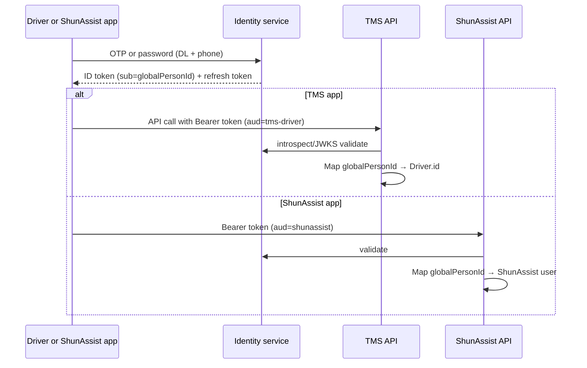
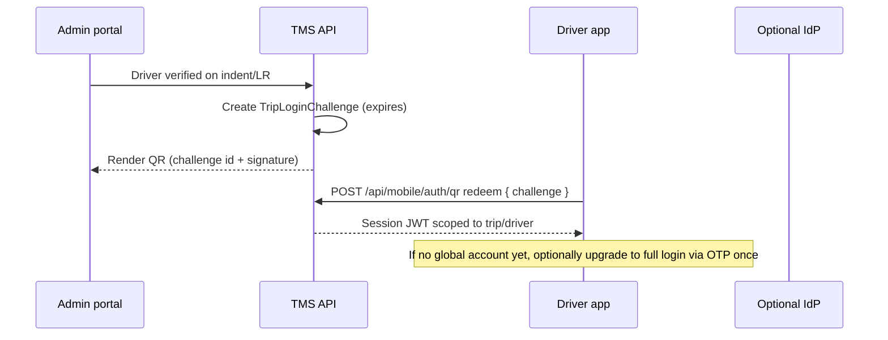

# Driver login across TMS and ShunAssist

**Status:** Planning — no code changes yet  
**Audience:** Product, engineering  
**Last updated:** October 2026

---

## 1. Problem statement

You are building a **native driver app** for TMS workflows (continuous GPS, trip status, POD) because browser-based tracking is unreliable for background location.

Later, **ShunAssist** will be a **separate product**: its own mobile app, backend, and database (jobs marketplace, training, insurance, subscriptions). Drivers should not maintain two unrelated identities if you can avoid it—but the two systems must stay **operationally and commercially separate**.

This document compares three approaches you raised, adds a recommended architecture, maps each option to **minimal schema changes**, and lists **application changes** in TMS (without implementing them now).

---

## 2. Current TMS baseline (as implemented today)

Understanding today’s model keeps “minimal change” honest.

| Concept | Where it lives | Notes |
|--------|----------------|-------|
| **Canonical driver identity** | `Driver.dlNumber` (unique, normalized) | Phone is **not** unique; multiple drivers may share a number. |
| **Driver login** | DL number + OTP; phone must match `Driver.phone` | Public OTP API + NextAuth credentials with `driverLogin=1`. |
| **Auth user row** | `User` with `role=DRIVER`, `driverId` → `Driver` | Created on first successful OTP login if missing. |
| **Indent verification OTP** | Same `Driver` OTP fields, purpose `driver_verify` | Separate from login; gates `DRIVER_ASSIGNED`. |
| **Session** | NextAuth JWT in cookie | Fine for web/PWA; mobile app will need token strategy (see §7). |

Relevant code paths (for future work):

- `prisma/schema.prisma` — `Driver`, `User`
- `src/lib/auth.ts` — driver OTP authorize path
- `src/lib/services/otp.service.ts` — `driver_login` / `driver_verify`
- `POST /api/drivers/otp/request` — mobile-friendly OTP request already exists

**Already planned elsewhere** (not all in schema yet):

- `Driver.shunAssistUserId`, `driverSource`, certification fields — see `docs/SCHEMA_AND_SCALE_ANALYSIS.md`, `docs/IMPLEMENTATION_PLAN.md`
- ShunAssist integration via **`ShunAssistAdapter`** (TMS talks to ShunAssist API; driver app was originally sketched as **one app, multiple experiences**)

Your new direction (**two apps, two backends**) does not invalidate the adapter idea; it changes **where login happens** and **how profiles stay in sync**.

---

## 3. Goals and constraints

| Goal | Implication |
|------|-------------|
| Same person, two products | Need a **stable cross-system identifier**, not necessarily one shared DB. |
| Separate ShunAssist backend/DB | ShunAssist owns jobs, courses, insurance; TMS owns indents, trips, LR, finance. |
| Minimal TMS schema churn | Prefer **link fields + events** over copying full profiles into a “master” table in TMS. |
| Good driver UX | Re-entering DL + phone on every app is acceptable short-term; long-term **one sign-in** is better. |
| Security | Trip-scoped access (GPS/POD) must not grant ShunAssist admin powers or vice versa. |

---

## 4. Industry patterns (delivery & logistics)

| Pattern | Example | Login model | Takeaway |
|---------|---------|-------------|----------|
| **Single partner app, one account** | Major food delivery partner apps | One phone OTP → one driver graph | Best UX; internal “products” are feature flags, not separate logins. |
| **Same brand, multiple apps, linked account** | Ride-hail / multi-vertical platforms | One account graph; app may ask “continue as …” | **Identity is centralized**; each app calls identity + product APIs. |
| **Shipper TMS vs driver marketplace** | Many 3PL + load boards | Often **two logins** unless explicitly integrated | Common pain point; integration usually means **SSO or shared IdP**, not one merged DB. |
| **Scan-to-start shift** | Warehouse / last-mile scan workflows | QR or barcode → **short-lived session** tied to job | Great for **trip/shift** login; not a replacement for marketplace account. |

**Delivery analogy for your case:** TMS is the **3PL execution system** (LR, trip, POD, payables). ShunAssist is the **driver lifecycle / gig / training platform**. Couriers often have one “partner ID” internally even when UIs differ—achieved with a **central identity**, not by storing everything in one application database.

---

## 5. Option 1 — “Master” identity + choose TMS vs ShunAssist at login

### 5.1 Idea

A **central place** stores the person (phone, DL, name, status). On login, the app asks **which product** (TMS driver vs ShunAssist) or routes by app bundle ID. Each product still has its own backend, but authentication validates against the shared identity.

### 5.2 Variants (important)

| Variant | Master table location | Verdict |
|---------|----------------------|---------|
| **A. Master table inside TMS Postgres** | TMS owns `Person`; ShunAssist reads/writes via API | Fast to start; **wrong long-term owner** if ShunAssist is independent. |
| **B. Dedicated Identity service** (recommended shape of “master”) | Small `identity` DB or Keycloak/Auth0/Cognito | Clean separation; both apps are OAuth/OIDC clients. |
| **C. ShunAssist owns identity; TMS is federated client** | ShunAssist IdP for independents; TMS links vendor drivers | Good if **most** users originate on ShunAssist; vendor-only drivers need a **linking** flow. |

“Master table” should mean **master identity**, not **master copy of all driver operational data**.

### 5.3 Minimal schema approach (TMS side)

Avoid a wide new table in TMS if you can. Smallest useful link model:

```text
Person (identity service OR thin TMS table)
  id                 cuid/uuid — globalPersonId
  primaryPhone       normalized E.164
  dlNumber           normalized (unique where legally one person per DL)
  status             ACTIVE | SUSPENDED

Driver (TMS — existing)
  ... existing fields ...
  globalPersonId     String? @unique   // link to identity service
  shunAssistUserId   String? @unique   // link to ShunAssist profile (already planned)

User (TMS — existing)
  ... optional: globalPersonId for future staff/portals
```

**Sync rule:** TMS `Driver` remains source of truth for **trip execution** (DL verification snapshot, device type, allocations). ShunAssist remains source of truth for **courses, job feed, insurance SKUs**. Only **identity + contact** fields sync both ways (with conflict policy).

### 5.4 Login flow (conceptual)



App selection can be implicit (**which app store build** you installed) rather than a “pick TMS or ShunAssist” screen on every login.

### 5.5 Pros and cons

| Pros | Cons |
|------|------|
| One OTP habit for drivers | Identity service is **new infrastructure** (unless you buy IdP) |
| Clear audit: one `sub` across products | Must define **account linking** when TMS creates driver before ShunAssist user exists |
| Scales to more products later | Migration from today’s TMS-only `User` rows |

### 5.6 TMS application changes (when you implement)

- Mobile: JWT access/refresh instead of (or in addition to) NextAuth cookie for `/api/mobile/*`.
- Auth middleware: validate OIDC token → resolve `driverId` via `globalPersonId` or `Driver.dlNumber` claim.
- Admin: show link status (TMS driver ↔ ShunAssist user); manual “link accounts” for support.
- Events: on `Driver` create/update, publish `driver.identity.updated` for ShunAssist consumer (or call adapter).

---

## 6. Option 2 — Fully separate logins (TMS vs ShunAssist)

### 6.1 Idea

Driver registers/logs in to TMS with DL + OTP (or vendor-created account). Separately registers/logs in to ShunAssist (phone OTP, email, etc.). No shared session.

### 6.2 When delivery-like companies do this

- Legacy TMS + third-party load board with **no integration**
- White-label carrier app vs national marketplace app
- B2B drivers (vendor roster) vs independent gig workers with **no prior relationship**

### 6.3 Pros and cons

| Pros | Cons |
|------|------|
| **Zero shared auth infra** day one | Drivers forget which app uses which number |
| Teams deploy on independent timelines | Duplicate KYC, duplicate profile edits |
| Clear security boundary | Hard to implement “certified pool” if IDs don’t match |
| | Support burden: “I logged into wrong app” |

### 6.4 Minimal schema (TMS)

Only what you already planned:

- `Driver.shunAssistUserId` — populated **manually or after** driver completes linking flow in ShunAssist (“enter TMS driver ID” / “link via OTP”).
- Optional `Driver.linkingStatus`: `UNLINKED | PENDING | LINKED`.

No master table required; **link is optional and late**.

### 6.5 Making separate logins tolerable

If you choose this for phase 1, add a **one-time linking** step (not two daily logins):

1. Driver logs into ShunAssist.
2. ShunAssist calls TMS (server-to-server) or shows “Verify with TMS OTP” to set `shunAssistUserId` on TMS `Driver`.

This is still “separate apps” but **one identity after linking**.

### 6.6 TMS application changes

- Admin/driver detail: display ShunAssist link ID and certification status (adapter).
- Pool assignment: refuse `driverSource=POOL` if `shunAssistUserId` null or certification API says not eligible.
- No change to current OTP login for TMS-only drivers.

---

## 7. Option 3 — QR login after LR / driver verification (admin-generated)

### 7.1 Idea

After ops enters and verifies driver on an indent/LR, admin portal shows a **QR code**. Driver scans in the TMS driver app to authenticate **without typing DL + phone** for that trip.

### 7.2 What the QR should contain (security)

Do **not** put long-lived secrets in the QR. Prefer:

- **Signed, short-lived token** (JWT or random id stored server-side)
- Claims: `tripId` or `indentId`, `driverId`, `tenantId` (future), `exp` (e.g. 15–60 minutes), optional `lrNumber`
- One-time use or bound to first device fingerprint

Flow:



### 7.3 Pros and cons

| Pros | Cons |
|------|------|
| Excellent **yard / dispatch** UX | Does **not** solve ShunAssist marketplace login by itself |
| Reduces wrong-driver login on shared phones | QR leakage if expiry too long; needs rate limits |
| Complements feature-phone drivers (vendor/ops scans for them) | Requires admin UI + print/share on LR slip |
| | Must still issue **refresh** strategy for multi-day trips |

### 7.4 Minimal schema (TMS)

New small table (preferred over overloading `Driver.otp*`):

```text
TripLoginChallenge (or DriverLoginChallenge)
  id              cuid
  driverId        FK Driver
  tripId          FK Trip? 
  indentId        FK Indent?
  tokenHash       String   // hash of QR secret
  expiresAt       DateTime
  consumedAt      DateTime?
  consumedByDevice String? // optional
  createdByUserId String?  // admin who generated
```

Reuse existing `Driver.dlNumber` binding after redeem if you create a full session.

### 7.5 Relation to ShunAssist

QR is **TMS trip bootstrap**. ShunAssist can use the same **pattern** for “scan to accept job offer” but should use **ShunAssist-issued** challenges, not TMS LR QR, unless tokens are federated (Option 1).

### 7.6 TMS application changes

- Indent/LR UI: “Show driver login QR” after driver verified / LR generated.
- API: create + redeem challenge; audit log.
- Mobile app: camera scan → session; fallback to DL+OTP if expired.
- Middleware: trip-scoped JWT may only call tracking/POD routes until full account login (policy choice).

---

## 8. Recommended strategy (our input)

Use a **phased combination**, not a single pure option.

| Phase | Product state | Login approach |
|-------|---------------|----------------|
| **Now – TMS driver app v1** | ShunAssist not live | **Keep DL + OTP** (already implemented); add **Option 3 QR** as optional convenience for dispatch. |
| **ShunAssist MVP** | Separate backend live | **Option 1B**: shared **Identity service** (or managed IdP) with two OAuth clients (`tms-driver-app`, `shunassist-app`). |
| **Data** | Two DBs | **Link only**: `globalPersonId` + `shunAssistUserId` on TMS `Driver`; ShunAssist stores `tmsDriverId` or same `globalPersonId`. |
| **UX** | Two app store listings | **No “pick product” screen**—each app knows its client id; same phone OTP at IdP feels like “same login”. |
| **Vendor-created drivers** | Driver exists in TMS first | On first ShunAssist open: “Verify your DL” → IdP links `sub` to existing person record. |

**Do not** put a full duplicate driver profile in a TMS “master table” that ShunAssist also writes to—that becomes a hidden shared database with two owners and conflict bugs.

**Do not** rely on Option 2 alone long term if pool/certification is core—`ShunAssistAdapter.getCertificationStatus(driverId)` needs a reliable ID map.

**Do** treat Option 3 as **execution UX**, not identity strategy.

### 8.1 Comparison to your original Option 1 wording

Your “master table + check TMS vs ShunAssist on login” is correct **if** the master is **identity-only** and app choice is implicit. If the master holds all driver data and both apps write to it, that violates “separate backend/db” and creates tight coupling.

### 8.2 Comparison to IMPLEMENTATION_PLAN “one React Native app”

Earlier docs described **one driver app** with gates (`driverSource`, certification). Two apps is still valid:

| One app | Two apps |
|---------|----------|
| Single install, switch experience inside | Clear branding & release cycles |
| One auth stack | Requires IdP or linking (this doc) |
| ShunAssist features hidden until certified | ShunAssist can ship training/insurance without TMS release |

You can share **one identity** with **two apps**—that is the usual compromise.

---

## 9. Decision matrix

| Criterion | Option 1 (shared identity) | Option 2 (separate logins) | Option 3 (QR) |
|-----------|----------------------------|------------------------------|---------------|
| Same login feel across apps | ★★★★★ | ★★ | ★★★ (TMS trips only) |
| Minimal new infra | ★★ | ★★★★★ | ★★★★ |
| Fits separate ShunAssist DB | ★★★★★ (with IdP) | ★★★★ | ★★★ |
| Dispatch / LR yard UX | ★★ | ★★ | ★★★★★ |
| Pool / certification integrity | ★★★★★ | ★★ (without linking) | ★ |
| Implementation risk | Medium | Low short / high long | Low–medium |

**Suggested decision:** **Option 1B (identity service) + Option 3 for TMS trip login**; avoid permanent Option 2 except as a **temporary** state before linking exists.

---

## 10. Schema change summary (minimal by option)

| Change | Option 1 (minimal link) | Option 2 | Option 3 |
|--------|-------------------------|----------|----------|
| `Driver.globalPersonId` | ✅ add | optional | optional |
| `Driver.shunAssistUserId` | ✅ add (planned) | ✅ primary link | optional |
| `Driver.linkingStatus` | optional | ✅ recommended | — |
| `TripLoginChallenge` table | — | — | ✅ add |
| New `Person` table **in TMS** | ⚠️ only if no IdP yet | — | — |
| `User` changes | optional `globalPersonId` | — | — |
| ShunAssist DB | `person_id`, `tms_driver_id` mirror links | same | job-specific challenges |

Already aligned with your roadmap (`driverSource`, `certificationStatus`, `poolDriverRequestId`) — see `docs/SCHEMA_AND_SCALE_ANALYSIS.md`.

---

## 11. TMS application changes checklist (future)

### 11.1 Auth & mobile

- [ ] Define token model for native app (access + refresh; Redis rotation per `IMPLEMENTATION_PLAN.md`).
- [ ] Either federate with IdP or extend current OTP to issue mobile JWTs (bridge until IdP live).
- [ ] Keep `driver_login` vs `driver_verify` purpose separation (already in schema).
- [ ] Device binding optional: reduce OTP fatigue on trusted devices (store refresh securely).

### 11.2 Admin & indent/LR

- [ ] QR generation on indent detail / LR print when driver assigned and verified.
- [ ] Audit: who generated QR, when redeemed.
- [ ] LR PDF: optional QR block (coordinate with `docs/lr-layout-spec.md`).

### 11.3 Integrations

- [ ] Implement `ShunAssistAdapter` for certification + pool (existing plan).
- [ ] Webhook or queue: `Driver` created/updated → ShunAssist profile upsert (identity fields only).
- [ ] ShunAssist → TMS: certification completed → set `certificationStatus` / allow pool assign.

### 11.4 Authorization rules

- [ ] TMS mobile token: scopes `trip:read`, `tracking:write`, `pod:write` bound to `driverId`.
- [ ] ShunAssist token: no access to TMS finance or unrelated trips.
- [ ] Support impersonation stays staff-only (unchanged).

### 11.5 What you can defer

- Full SSO for **vendor/client** portals (driver is the urgent path).
- Merging ShunAssist UI into TMS web `/driver` PWA (native app replaces GPS use case).

---

## 12. Open product questions

1. **Who creates the identity first?** Vendor-onboarded drivers (TMS-first) vs independents (ShunAssist-first)—linking flow order differs.
2. **One phone, many drivers** (schema allows shared phone): OTP to phone alone cannot disambiguate; DL remains mandatory for TMS (already correct).
3. **Feature-phone drivers:** QR scanned by vendor/ops vs no ShunAssist app—pool/certification may be irrelevant; TMS execution only.
4. **Insurance sold in ShunAssist:** policy IDs stay in ShunAssist DB; TMS might only store `insuranceVerifiedAt` flag for compliance snapshots.

---

## 13. References in this repo

| Document | Relevance |
|----------|-----------|
| `docs/IMPLEMENTATION_PLAN.md` §2.2–2.3 | ShunAssist adapter, mobile API sketch, one-app gating |
| `docs/ARCHITECTURE_AND_USER_FLOW.md` §6.1 | ShunAssist roles (certification + pool) |
| `docs/SCHEMA_AND_SCALE_ANALYSIS.md` | `shunAssistUserId`, `driverSource`, certification fields |
| `docs/SAAS_PLATFORM_GUIDE.md` §5.7 | Mobile driver auth note (tenant + OTP) |
| `src/lib/auth.ts` | Current driver OTP login behavior |

---

## 14. One-paragraph recommendation for stakeholders

Build the TMS driver app with **existing DL + OTP**, add **QR trip login** for dispatch convenience, and plan ShunAssist as a separate system linked by a **shared identity service** (not a fat master table in TMS). Store only **foreign keys** (`globalPersonId`, `shunAssistUserId`) on TMS `Driver`, sync profile and certification via API/events, and issue **product-scoped tokens** so one phone OTP feels like one account while backends and databases stay separate.
