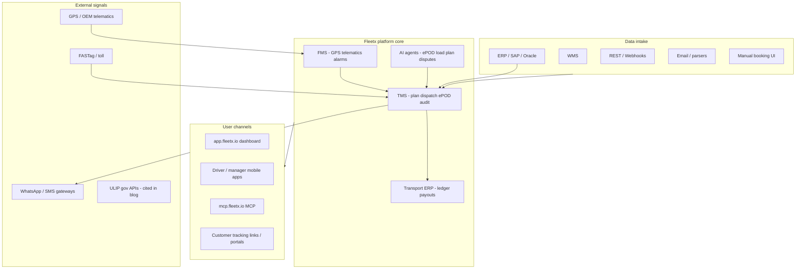
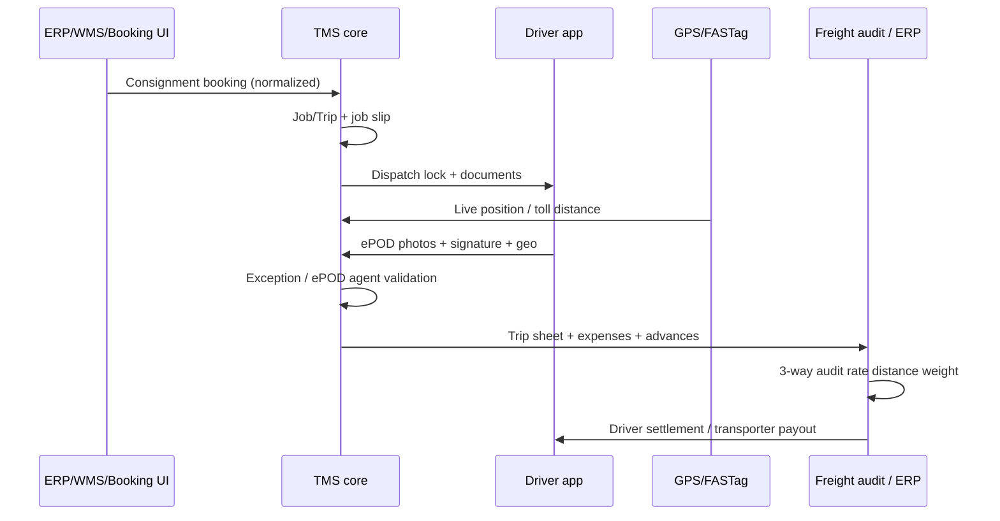

# Fleetx TMS — REA & Public-Surface Analysis

**Subject:** [Fleetx Transport Management System](https://www.fleetx.ai/transporter-management-system) (Fleetx.ai — India enterprise fleet & logistics platform)  
**Analysis date:** 24 October 2026  
**Analyst scope:** Reverse-engineering and public evidence only (no customer credentials)

---

## 1. Executive summary

Fleetx positions its TMS as an **agentic, end-to-end freight operations layer**: ingest orders and capacity from fragmented systems, plan and auto-dispatch trips, track execution with telematics, validate **ePOD**, run **three-way freight audit** (rate / distance / weight), and feed **settlement & ERP/finance**. It sits inside a broader **“intelligence platform”** alongside FMS (visibility), fuel, video telematics, and Transport ERP, with a **unified data model** exposed via REST APIs and **Fleetx MCP** (`https://mcp.fleetx.io/mcp`).

This document maps **dispatch workflow**, **data intake**, **inferred product architecture**, **user flows**, **marketing UI patterns**, and a **practical blueprint to build a comparable TMS SaaS**, with **evidence IDs** for every major claim.

> **Important limitation:** The live operations product runs at `app.fleetx.io` behind login (`signup.fleetx.com`). This analysis did **not** access authenticated dashboards. Product behavior is inferred from official marketing, Fleetx blog, MCP/npm documentation, passive browser inspection of public pages, and mobile app store listings. Treat internal screen layouts as **hypotheses** validated only where blog/MCP name concrete modules (jobs, consignments, live tracking, tickets, etc.).

---

## 2. Methodology & evidence register

| ID | Source type | What was observed |
|----|-------------|-------------------|
| **E-TMS** | Marketing page | [transporter-management-system](https://www.fleetx.ai/transporter-management-system) — lifecycle tabs, feature blocks, FAQ |
| **E-A11Y** | REA-adjacent passive UI | Browser accessibility tree on E-TMS; lifecycle tab states (`pressed`/`released`) and dynamic panel copy when switching tabs |
| **E-BLOG-D2D** | Official blog | [How a TMS Works: Dispatch to Delivery](https://blog.fleetx.ai/how-a-tms-works-from-dispatch-to-delivery-in-transportation-and-fleet-management/) — 6-stage lifecycle, FMS vs TMS vs ERP |
| **E-BLOG-SETTLE** | Official blog | [Trip settlement at scale](https://blog.fleetx.ai/from-settlement-delays-to-seamless-payouts-how-enterprise-fleets-are-automating-trip-settlement-at-scale/) — consignment → payout chain |
| **E-ERP** | Marketing page | [Transporter ERP](https://www.fleetx.ai/transporter-erp) — module rail, agents, payments |
| **E-FAP** | Marketing page | [Freight Audit & Payment](https://www.fleetx.ai/freight-audit-payment) |
| **E-MCP** | Blog + npm | [Fleetx MCP announcement](https://blog.fleetx.ai/fleetx-mcp-bring-your-fleetx-data-into-claude-chatgpt-and-your-own-agents/), [@fleetx_io/fleetx-mcp-server](https://www.npmjs.com/package/@fleetx_io/fleetx-mcp-server) |
| **E-LOGIN** | Passive CDP (signup) | `signup.fleetx.com/login` — Vite bundles, Livewire, Sentry, Google OAuth link, reCAPTCHA |
| **E-CMS** | Passive CDP (marketing) | `www.fleetx.ai` — Next.js image pipeline (`/_next/image`), CMS assets on `assets.fleetx.io`, GTM/HubSpot |
| **E-APP** | Store listing | [Google Play — io.fleetx](https://play.google.com/store/apps/details?id=io.fleetx) — mobile feature list |
| **E-HOME** | Marketing | [fleetx.ai home](https://www.fleetx.ai/) — five-product stack |

---

## 3. Product context: where TMS sits in Fleetx

### 3.1 Five-product stack (single AI engine)

**Finding:** Fleetx markets five products on one “intelligence” stack: TMS, Video & Camera, Fleet Visibility, Fuel Monitoring, Transport ERP. TMS tagline: *“Plan, dispatch, and settle freight end to end.”*  
**Evidence:** E-HOME

### 3.2 FMS vs TMS vs Transport ERP (division of labor)

| Layer | Question it answers | Controls (per Fleetx) | Typical user |
|-------|---------------------|------------------------|--------------|
| **FMS / Fleet Visibility** | Where are vehicles and how are they driven? | GPS, speed, fuel, behaviour | Fleet & safety |
| **TMS** | How to plan, dispatch, settle each load? | Orders, routes, ePOD, freight audit | Dispatch / logistics ops |
| **Transport ERP** | How to run billing, branches, P&L? | Finance, invoicing, settlements, compliance | Finance / owners |

**Evidence:** E-BLOG-D2D (comparison table); E-ERP (operations → accounting rail)

### 3.3 Unified data model & surfaces

**Finding:** Telematics, TMS, ERP, finance, safety, and maintenance share **one data model**; dashboard, mobile apps, REST API, and MCP read the same permissioned data (no separate sync copies for MCP).  
**Evidence:** E-MCP (“One data model, one permission model, many surfaces”)

**Inferred architecture (high level):**



---

## 4. Core dispatch workflow

Fleetx describes **two complementary workflow models** that align if you treat the “agentic lifecycle” as the control plane and the settlement blog as the document chain.

### 4.1 Six-stage “Agentic Lifecycle” (primary TMS narrative)

Interactive marketing control: **six toggle buttons** map 1:1 to stages; selecting a tab updates the hero panel (verified via E-A11Y).

| Stage | UI label (E-A11Y) | Capabilities claimed |
|-------|-------------------|----------------------|
| 1 | **Input Data** | Order capture; resource mapping (contracts, RFQs, spot auctions); data standardization |
| 2 | **Plan Intelligently** | Smart route optimization; predictive risk; cost & utilization optimization |
| 3 | **Review Exceptions** | Exception detection; human-in-the-loop approve/override; compliance vs SLAs |
| 4 | **Dispatch Automatically** | (Section below fold) Multi-evidence analysis, auto-assign, 3D load building, document generation |
| 5 | **Proof & Settlement** | ePOD verification; freight reconciliation; settlement automation |
| 6 | **Performance Insights** | (Tab present; detailed copy not expanded in snapshot — reporting/analytics implied) |

**Evidence:** E-TMS, E-A11Y (tabs e5–e10), E-BLOG-D2D (narrative stages 1–6)

#### Stage 1 — Input Data (data intake modules)

| Module | Function |
|--------|----------|
| **Order Capture** | Pull shipment requests from ERP, WMS, APIs, email, external systems |
| **Resource Mapping** | Vehicles, drivers, routes, capacity; sourcing via **long-term contracts, RFQs, spot auctions** |
| **Data Standardization** | Normalize to unified schema for execution |

**Evidence:** E-TMS, E-A11Y (Input Data panel), E-BLOG-D2D stage 1

#### Stage 2 — Plan intelligently

| Submodule | Function |
|-----------|----------|
| Smart Route Optimization | Routes by distance, delivery timelines, constraints |
| Predictive Risk Detection | Delays, bottlenecks, capacity risk before execution |
| Cost & Utilization Optimization | Fleet utilization, cost, turnaround |

**Evidence:** E-A11Y (Plan Intelligently panel)

#### Stage 3 — Review exceptions (human-in-the-loop)

| Submodule | Function |
|-----------|----------|
| Exception Detection | Mismatches and anomalies surfaced for validation |
| Human-in-the-Loop Validation | Approve or override agent recommendations |
| Compliance Assurance | Plans vs business rules, SLAs, policies |

**Evidence:** E-A11Y (Review Exceptions panel — note marketing typo “Review Expections” in a11y name)

#### Stage 4 — Dispatch & execution

| Capability | Function |
|------------|----------|
| Multi-evidence analysis | Auto-assign using truck availability, route efficiency, **dealer delivery windows** |
| Dispute classification | Fill rate, empty return, per-tonne cost |
| **3D Load Building Agent** | Volume/sequence optimization for unload order |
| Evidence validation | Auto delivery orders, **weighbridge slips**, compliance docs |
| Live tracking | GPS during trip; ULIP mentioned for gov logistics APIs (E-BLOG-D2D) |

**Evidence:** E-TMS, E-BLOG-D2D stages 3–4

#### Stage 5 — Proof & settlement

| Submodule | Function |
|-----------|----------|
| ePOD Verification | AI validation of POD docs, quantities, confirmations |
| Freight Reconciliation | Rates vs invoices vs operational data |
| Settlement Automation | Transporter billing, approvals, payouts |

**Evidence:** E-A11Y (Proof & Settlement panel), E-TMS (ePOD agent, freight audit section)

#### Stage 6 — Performance insights

Trip-level feedback into cost, turnaround, delays, driver behaviour for next planning cycle.  
**Evidence:** E-BLOG-D2D stage 6

---

### 4.2 Operational document chain (consignment → payout)

Parallel workflow emphasized for **market / hired vehicles** and finance:



| Step | Entity | Description |
|------|--------|-------------|
| 1 | Consignment booking | From ERP, WMS, or manual screen → standardized |
| 2 | Job / trip | Assign market vehicle + driver; job slip for transporter & driver |
| 3 | Dispatch | Lock vehicle/driver; generate load docs; start tracking |
| 4 | ePOD | Driver captures evidence; flag “delivered” without valid ePOD |
| 5 | Automated settlement | Net advance vs fuel, toll, detention; trip sheet as source doc |

**Evidence:** E-BLOG-SETTLE; E-ERP (Consignment → Job Slip → Dispatch → ePOD → Arrival)

**Supporting finance objects (blog):** Driver Settlement, Driver Ledger, Expense Ledger, Trip Sheet, AI receipt reading from driver-captured photos.  
**Evidence:** E-BLOG-SETTLE

---

### 4.3 ePOD dispute & escalation workflow

| Rule / action | Detail |
|---------------|--------|
| Payment policy | **Strict POD-based payment** — no pay without valid proof |
| Missing ePOD | Trip marked delivered without ePOD → instant AI flag |
| Accountability | Carrier fault → transporter follow-up; customer fault → plant ops |
| Escalation | T+0 WhatsApp → driver; T+2h SMS → supervisor |
| Impact metrics | Up to 70% less manual dispute work; 3–5× faster resolution |

**Evidence:** E-TMS, E-BLOG-D2D

---

### 4.4 Freight audit & payment (three-way validation)

| Check | Inputs |
|-------|--------|
| **Base rate** | Invoice vs live contract — lane + vehicle type + charge basis |
| **Distance** | GPS + FASTag km/time vs contract; auto-deduct if overbilling **>5%** |
| **Weight** | Loaded vs invoiced vs ePOD document |

Additional FAP product themes: hierarchical permissions, accruals, customizable audit rules, document repository, SAP integration, realtime cost tracking.  
**Evidence:** E-TMS, E-FAP, E-BLOG-SETTLE

---

## 5. Data intake modules (consolidated)

| Channel | Data types | Downstream use |
|---------|------------|----------------|
| ERP / SAP / Oracle | Orders, master data | Order capture → planning |
| WMS | Shipment requests | Same |
| REST API / webhooks | Orders, status, master sync | Integration hub (150+ integrations claimed on ERP page) |
| Email / external parsers | Unstructured requests | Standardization layer |
| Manual TMS UI | Bookings, corrections | Same |
| Contracts / RFQ / spot auction | Capacity & rates | Resource mapping & procurement |
| GPS / OEM telematics | Position, behaviour, alarms | Dispatch tracking, distance audit, safety |
| FASTag / toll | Distance, cost | Distance validation |
| Driver app | ePOD, expenses, receipts | Settlement & audit |
| WhatsApp / SMS | Exception nudges | ePOD recovery |
| ULIP (gov) | Logistics gov data | Tracking/compliance (blog reference) |

**Evidence:** E-TMS, E-ERP, E-BLOG-D2D, E-MCP (integrations narrative), E-APP

---

## 6. Inferred application architecture (SaaS)

### 6.1 Publicly observable tech surfaces

| Surface | Stack signals | Evidence |
|---------|---------------|----------|
| Marketing `www.fleetx.ai` | Next.js image optimizer, CMS on `assets.fleetx.io`, GTM, HubSpot chat, Clarity | E-CMS |
| Auth `signup.fleetx.com` | Vite-built assets, **Laravel Livewire**, Sentry, Google OAuth, reCAPTCHA | E-LOGIN |
| Operations `app.fleetx.io` | Separate SPA/dashboard (login-gated); realtime overview URL cited publicly | E-MCP, web search |
| API integration | REST + webhooks + MQTT event streaming (marketing); MCP proxies **Fleetx REST** with dynamic tools | E-MCP, npm changelog |
| MCP server | OAuth 2.1 PKCE, Google → `POST /api/v2/login/google-one-tap`, SQLite token store, AES-256-GCM | npm changelog E-MCP |

### 6.2 Domain modules (from ERP + MCP + mobile)

**Transport ERP module rail (E-ERP):** Operations → Collections → Settlement → Maintenance → Accounting → Compliance

**Operations entities:** Order Booking, FTL/PTL Consignment, Challan, Job, Hireslip, ePOD

**MCP-cross-cutting entities (E-MCP):** Jobs, trips, consignments, vehicles, alarms, fuel, tickets, renewals, vehicle/route P&L

**Mobile ops (E-APP):** Jobs, trips, dispatch/routes, ePOD, expenses, invoicing, utilization, maintenance, FASTag, SIM tracking

### 6.3 Agent layer (product differentiation)

Marketing and MCP roadmap cite agents for:

- Onboarding / widget customization  
- Operations, Collection, Reconciliation, Settlement (ERP page)  
- ePOD validation, consignment creation, freight rates, freight disputes (MCP “what’s next”)  
- 3D load building, multi-evidence dispatch analysis (TMS page)

**Evidence:** E-TMS, E-ERP, E-MCP

### 6.4 Security & tenancy (inferred)

- **Multi-tenant / 3PL:** FAQ on TMS page — multi-client architecture, data separation, white-label portals, per-client rules  
- **RBAC:** MCP enforces same permissions as UI; ERP mentions maker-checker-approver payouts  
- **Audit:** Payout trace voucher → approval → execution; freight audit rules  

**Evidence:** E-TMS FAQ (E-A11Y e14), E-MCP, E-ERP

---

## 7. User flows (by persona)

### 7.1 Dispatcher / control tower

1. Orders appear in unified queue (ERP/API/email/manual).  
2. System proposes assignments (availability, route, delivery windows) → exceptions queue for human review.  
3. Approve/override → dispatch locks resources, generates docs, activates tracking.  
4. Monitor live map + alarms; intervene on delays/deviations.  
5. Close trip via ePOD validation; release for audit/settlement.

**Evidence:** E-BLOG-D2D, E-A11Y, E-MCP (live tracking + job + alarms narrative)

### 7.2 Planner (exception-first)

Focus on **Review Exceptions** tab: only flagged capacity clashes, window risks, compliance conflicts — not every order.  
**Evidence:** E-A11Y, E-BLOG-D2D stage 3

### 7.3 Driver (mobile)

Receive job → navigate → auto arrival detection → capture ePOD (photo/signature/geo) → submit expenses (AI receipt scan) → see job slip / settlement status.  
**Evidence:** E-APP, E-BLOG-SETTLE

### 7.4 Finance / freight audit

Invoice lands → automated rate/distance/weight checks → risk classification → accrual/settlement → SAP/ERP post → transporter payout with approvals.  
**Evidence:** E-FAP, E-TMS, E-ERP

### 7.5 Customer support (cross-module)

Legacy flow: tracking screen + dispatch job + alarms + phone + WhatsApp link + ticket (~30 min).  
Target flow with MCP: single natural-language request → job + location + alarms + tracking link + draft ticket.  
**Evidence:** E-MCP

### 7.6 Fleet owner / branch manager

P&L by trip/route/vehicle, utilization, safety scorecards, renewal compliance — via dashboard or MCP analytics tools.  
**Evidence:** E-HOME, E-MCP, E-BLOG-D2D safety section

---

## 8. UI layout patterns (marketing site → product UX hypotheses)

Public TMS page patterns useful for **clone UX specification**:

| Pattern | Description | Evidence |
|---------|-------------|----------|
| **Lifecycle tab bar** | Horizontal 6-step process navigator with `pressed` state on active stage; swaps hero title + 3 bullet pillars | E-A11Y |
| **Hero + KPI strip** | H1 value prop + metrics (5L vehicles, 1B+ data points/day, etc.) | E-TMS |
| **Section bands** | Alternating deep dives: Dispatch & Route Planning → ePOD Dispute → Freight Audit | E-TMS |
| **Metric cards** | Industry case studies (Cement / Enterprise / Pharma) with scale + outcome KPIs | E-TMS |
| **FAQ accordion** | Long-form SEO + feature enumeration (order mgmt, tendering, dock scheduling, EDI, etc.) | E-A11Y e11–e17 |
| **Dual CTA** | “Schedule Platform Demo” + “Watch Product Demo” | E-A11Y |
| **MCP banner** | Top-of-page integration story for AI tools | E-A11Y |
| **Global chrome** | Product footer links (TMS, ERP, FMS, Fuel, Video), bilingual selector (EN/HI) | E-A11Y |

**Product UI (inferred, not directly observed):** Multi-screen ops (MCP cites live tracking, dispatch job, alarms, tickets) suggests **left-nav module shell**, **map-first realtime view**, and **entity-centric lists** (jobs, consignments, trips) — align clone with dispatch board + exception inbox + trip detail drawer.

---

## 9. How to build a Fleetx-class TMS SaaS (blueprint)

### 9.1 MVP scope (parity with public Fleetx TMS story)

**Phase 1 — Core ops (8–12 weeks for a focused team)**

- Multi-tenant org model + RBAC  
- Master data: customers, lanes, plants, transporters, vehicles, drivers  
- **Order/consignment intake:** REST API + CSV + manual form  
- **Planning:** rules-based assignment + manual override queue  
- **Dispatch:** trip/job entity, job slip PDF, status machine  
- **Tracking:** integrate one GPS provider; map view  
- **ePOD:** mobile web/PWA with photo + signature + geostamp  
- **Basic freight audit:** contract rate table + invoice upload + pass/fail  

**Phase 2 — Enterprise differentiators**

- ERP connector (SAP/Oracle/Tally)  
- FASTag/toll distance ingestion  
- Three-way audit with configurable thresholds (e.g. 5% distance variance)  
- WhatsApp/SMS escalation playbooks  
- Exception inbox + approval workflows  
- Document vault (weighbridge, POD, invoices)  

**Phase 3 — “Agentic” layer**

- OCR/LLM on receipts and POD  
- Auto-assign optimizer (OR-Tools / VRP) + optional 3D bin packing  
- Dispute classifier + recommended owner  
- MCP or OpenAPI for customer AI integrations  

### 9.2 Recommended data model (minimal)

```
Organization
  ├── Branch
  ├── Customer / Shipper
  ├── Transporter / Carrier
  ├── Contract (lane, vehicle_type, charge_basis, rates)
  ├── Vehicle ── Driver
  ├── Consignment (FTL/PTL, weight, volume, windows)
  │     └── Trip/Job (status, assigned resources)
  │           ├── DispatchEvent[]
  │           ├── TrackingPoint[] (telemetrics)
  │           ├── Document[] (challan, weighbridge)
  │           ├── EPOD (media, geo, validated_at)
  │           ├── Expense[] (fuel, toll, detention)
  │           └── Settlement (advance, net, ledger_entries)
  ├── Invoice (carrier bill)
  └── AuditResult (rate, distance, weight checks)
```

### 9.3 Service architecture (cloud-native)

| Service | Responsibility |
|---------|----------------|
| **api-gateway** | Auth, tenancy, rate limits |
| **order-service** | Intake, normalization, idempotency |
| **planning-service** | Assignment solver, exception scoring |
| **dispatch-service** | State machine, document generation |
| **tracking-ingest** | GPS webhooks, FASTag, MQTT |
| **epod-service** | Media storage, validation rules, agent hooks |
| **audit-service** | Rules engine, SAP export |
| **notification-service** | WhatsApp, SMS, email |
| **integration-hub** | ERP/WMS adapters, webhook dispatcher |
| **reporting** | OLAP / BI, route P&L |

Event bus (Kafka/SNS) for: `consignment.created`, `trip.dispatched`, `epod.submitted`, `audit.failed`, `settlement.approved`.

### 9.4 Frontend surfaces

| App | Users | Key screens |
|-----|-------|-------------|
| **Ops web** | Dispatch, planners | Order queue, exception inbox, dispatch board, trip detail, map |
| **Finance web** | Audit, AP | Invoice workbench, audit findings, approval chains |
| **Driver mobile** | Drivers | Job list, navigation deep link, ePOD capture, expense camera |
| **Customer portal** | Shippers | Track & trace, POD download (optional white-label) |
| **Admin** | Tenant admin | Users, contracts, integration keys, audit rules |

### 9.5 Commercial & GTM (mirroring Fleetx FAQ)

- **3PL mode:** tenant → sub-tenant per shipper, isolated data, custom workflows  
- **Pricing axis:** per vehicle/month modules (indicative ranges cited in E-BLOG-D2D FAQ)  
- **Implementation:** pilot lane → ERP integrate → carrier onboarding → UAT  
- **ROI narrative:** utilization, admin reduction, on-time %, freight leakage  

**Evidence:** E-TMS FAQ (E-A11Y), E-BLOG-D2D

### 9.6 Differentiation checklist vs “generic TMS”

Fleetx’s public wedge is **not** dispatch alone — it is:

1. **Closed loop to money** (ePOD-gated pay + 3-way audit + ERP)  
2. **Telematics-native distance** (GPS + FASTag)  
3. **India-specific money flows** (TDS, UPI/NEFT/RTGS payouts, Tally — E-ERP)  
4. **Agents** on exceptions, not full manual planning  
5. **Unified platform** with FMS/ERP/MCP  

Design your clone’s moat around 1–2 of these initially (usually **audit + telematics distance** for shippers, or **market vehicle settlement** for transporters).

---

## 10. API & integration strategy (evidence-based)

| Mechanism | Use |
|-----------|-----|
| REST API | CRUD on jobs, vehicles, trips; dynamic surface via MCP |
| Webhooks | Order/status events to shipper systems |
| MQTT | Real-time event streaming (marketing) |
| MCP `https://mcp.fleetx.io/mcp` | AI agents with OAuth; tools generated per enabled modules |
| Local MCP npm | `@fleetx_io/fleetx-mcp-server` for dev/stdin |

Example tool names from npm docs: `vehicle_listing`, `vehicle_realtime_api`, `create_job`, `job_status_api`, trip history by vehicle, tags, analytics.

**Evidence:** E-MCP, npm package

For a **greenfield SaaS**, ship **OpenAPI + webhooks first**, add **MCP** once core entities stabilize (same pattern Fleetx uses).

---

## 11. Gaps & recommended follow-up research

| Gap | Why it matters | Suggested action |
|-----|----------------|------------------|
| Authenticated `app.fleetx.io` UI | Exact dispatch board layout, menus, widgets | Demo account or screen recording from sales |
| Full OpenAPI spec | Implementation fidelity | Customer API docs or MCP `fleetx-api-reference` resource with login |
| Agent internals | Model features, SLAs | Not public — treat as black-box services behind rules + ML |
| vs fleetx.com (EU TMS) | Different company/product | Do not mix with fleetx.ai analysis |

---

## 12. Source links (quick reference)

- TMS marketing: https://www.fleetx.ai/transporter-management-system  
- Transport ERP: https://www.fleetx.ai/transporter-erp  
- Freight audit: https://www.fleetx.ai/freight-audit-payment  
- Dispatch-to-delivery blog: https://blog.fleetx.ai/how-a-tms-works-from-dispatch-to-delivery-in-transportation-and-fleet-management/  
- Settlement blog: https://blog.fleetx.ai/from-settlement-delays-to-seamless-payouts-how-enterprise-fleets-are-automating-trip-settlement-at-scale/  
- Fleetx MCP: https://blog.fleetx.ai/fleetx-mcp-bring-your-fleetx-data-into-claude-chatgpt-and-your-own-agents/  
- Login: https://signup.fleetx.com/login  
- MCP endpoint: https://mcp.fleetx.io/mcp  
- npm MCP server: https://www.npmjs.com/package/@fleetx_io/fleetx-mcp-server  

---

## 13. REA session notes

- **inspect_web_page / analyze_web_bundle:** Require external loopback CDP endpoint + `target_id`; Cursor’s embedded browser CDP was accessed via **browser_cdp** `Runtime.evaluate` instead for script fingerprinting on `signup.fleetx.com` and `www.fleetx.ai`.  
- **Lifecycle UI:** Verified dynamic content via accessibility snapshots after tab clicks (E-A11Y).  
- **No binary/mobile APK analysis** was performed; mobile behaviour cited from Play Store listing only (E-APP).

---

*End of report.*
