# Shunlink TMS — SaaS Platform Guide

**Version:** 1.0  
**Audience:** Product, engineering, DevOps  
**Status:** Planning reference (no application code changes implied by this document)  
**Last updated:** October 2026

**Companion docs**

| Document | Purpose |
|----------|---------|
| [DATABASE_SCHEMA.md](./DATABASE_SCHEMA.md) | Multi-tenant data model, indent normalization |
| [MIGRATION.md](./MIGRATION.md) | v1 single-tenant → SaaS schema migration |
| [DEVELOPER_CODEMAP.md](./DEVELOPER_CODEMAP.md) | Current TMS routes, APIs, services |
| [ARCHITECTURE.md](./ARCHITECTURE.md) | POD, advance, email, SLA (tenant business logic) |
| [IMPLEMENTATION_PLAN.md](./IMPLEMENTATION_PLAN.md) | TMS feature phases |

**Current codebase reality:** Production schema is single-tenant (`prisma/schema.prisma` — no `tenantId`). This guide describes the **target SaaS product** built from the same TMS feature set, with a platform layer added on top.

---

## Table of contents

1. [Executive summary](#1-executive-summary)
2. [Product layers and actors](#2-product-layers-and-actors)
3. [SaaS architecture](#3-saas-architecture)
4. [Domains and request routing](#4-domains-and-request-routing)
5. [Authentication](#5-authentication)
6. [Authorization](#6-authorization)
7. [Entitlements, plans, and add-ons](#7-entitlements-plans-and-add-ons)
8. [Platform workflows](#8-platform-workflows)
9. [Tenant TMS workflows](#9-tenant-tms-workflows)
10. [User flows by persona](#10-user-flows-by-persona)
11. [Data and isolation](#11-data-and-isolation)
12. [Infrastructure and operations](#12-infrastructure-and-operations)
13. [Security and compliance](#13-security-and-compliance)
14. [Implementation roadmap](#14-implementation-roadmap)
15. [Appendix: base vs add-on matrix](#15-appendix-base-vs-add-on-matrix)

---

## 1. Executive summary

Shunlink TMS as a **SaaS** means:

- **One deployed application** serves many **3PL companies (tenants)**.
- Each tenant gets isolated data, branding, subdomain (`{slug}.shunlinktms.in`), and optional custom domain.
- **Shunlink (platform)** sells subscriptions, provisions tenants, enables paid **add-ons**, and handles billing — without seeing tenant operational data except through **audited support** tools.
- **Tenant users** (admin, ops, finance, client, vendor, driver) use the same journeys as today’s TMS, scoped to their company only.

**Recommended tenancy model:** shared PostgreSQL + shared app instances + **row-level isolation** via `tenantId` on every business row. Enterprise customers may later get a dedicated database or environment.

**Do not fork the codebase** into “TMS” vs “SaaS TMS.” Evolve one monolith with:

- Platform routes (`console.*`)
- Tenant resolution from hostname
- Entitlement checks alongside existing RBAC permissions

---

## 2. Product layers and actors

### 2.1 Three layers

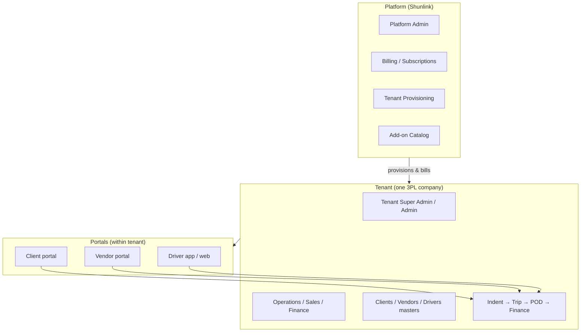

### 2.2 Actor matrix

| Actor | Layer | Typical entry URL | Primary goals |
|-------|--------|-------------------|---------------|
| **Platform Admin** | Platform | `https://console.shunlinktms.in` | Tenants, plans, add-ons, support, global health |
| **Tenant Super Admin** | Tenant | `https://{slug}.shunlinktms.in` | Full tenant config, users, billing contact |
| **Admin / Ops / Finance / Sales** | Tenant | Same host, employee login | Run 3PL operations |
| **Client** | Tenant portal | `{slug}.shunlinktms.in/login/client` | Requirements, shipments, invoices |
| **Vendor** | Tenant portal | `{slug}.shunlinktms.in/login/vendor` | Quotes, trips, POD, payments |
| **Driver** | Tenant portal | `{slug}.shunlinktms.in/login/driver` | Tracking, POD, OTP login |

### 2.3 Role rename (conceptual)

| Today (single-tenant) | SaaS meaning |
|----------------------|--------------|
| `SUPER_ADMIN` | **Tenant** super admin (full permissions inside one `tenantId`) |
| *(new)* `PLATFORM_ADMIN` | Shunlink staff; **no** default access to tenant business tables |
| `ADMIN`, `OPERATIONS`, … | Unchanged; always scoped to `tenantId` in session |
| `CLIENT`, `VENDOR`, `DRIVER` | Unchanged; scoped to tenant + `clientId` / `vendorId` / `driverId` |

---

## 3. SaaS architecture

### 3.1 Logical architecture

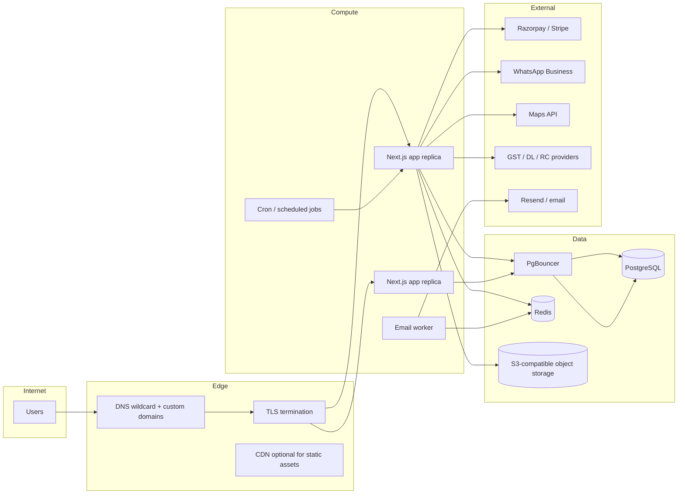

### 3.2 Application modules (single repo)

```
src/
  app/
    (platform)/              # NEW: console.shunlinktms.in
    (dashboard)/             # Tenant staff UI (existing)
    portal/client|vendor/    # Tenant portals (existing)
    driver/                  # Driver UI (existing)
    api/
      platform/              # NEW: tenant CRUD, billing webhooks (platform auth)
      ...                    # Existing tenant APIs (tenant auth + tenantId scope)
  lib/
    platform/                # NEW: tenant resolution, entitlements, provisioning
    services/                # Existing domain services (+ tenantId parameter)
    permissions.ts           # Existing RBAC keys → map to entitlements
  middleware.ts              # EXTEND: host → tenant; platform vs tenant routes
```

### 3.3 Request context (every tenant request)

After middleware runs, the request carries:

| Field | Source | Used for |
|-------|--------|----------|
| `tenantId` | Host lookup + session validation | All DB queries |
| `tenantSlug` | Host | URLs, branding |
| `tenantStatus` | `Tenant.status` | Block `SUSPENDED` / `PAST_DUE` |
| `userId`, `role` | JWT | RBAC |
| `entitlements` | Resolved from plan + add-ons | Feature gates |
| `permissions` | RBAC service | Fine-grained actions |

Platform console requests carry `platformUserId` and **never** set `tenantId` unless entering **support mode** (audited).

### 3.4 Deployment topology (default)

| Component | Multi-tenant default | Enterprise option |
|-----------|----------------------|-------------------|
| App containers | Shared fleet | Dedicated namespace |
| PostgreSQL | One cluster, RLS optional later | Dedicated DB |
| Redis | Shared, key prefix per tenant | Dedicated instance |
| Object storage | Bucket with `{tenantId}/` prefix | Dedicated bucket |
| Background jobs | Queue jobs include `tenantId` | Same |

---

## 4. Domains and request routing

### 4.1 Hostname map

| Host | Purpose |
|------|---------|
| `shunlinktms.in` | Marketing, pricing, legal, optional self-serve signup |
| `console.shunlinktms.in` | Platform admin console |
| `{slug}.shunlinktms.in` | Full TMS for tenant `{slug}` |
| `tms.customer.com` | Custom domain (add-on); maps via `TenantDomain` |

### 4.2 Tenant resolution flow

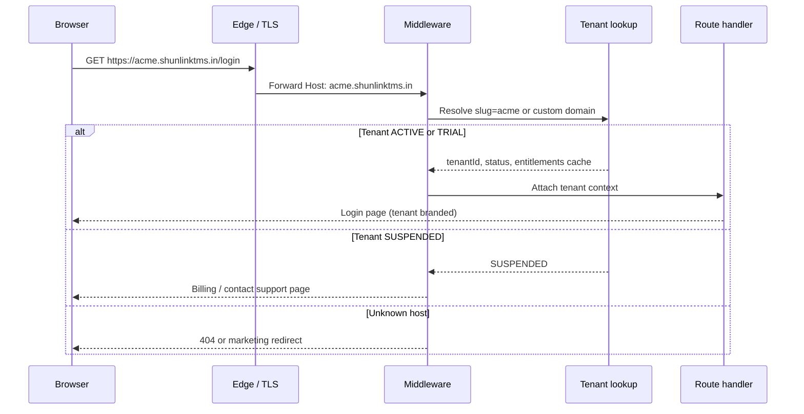

### 4.3 Route classes

| Class | Host examples | Auth |
|-------|---------------|------|
| **Public marketing** | `shunlinktms.in` | None |
| **Platform** | `console.shunlinktms.in` | Platform session |
| **Tenant public** | `{slug}.../welcome`, `/login/*`, `/onboard/*` | None until login |
| **Tenant authenticated** | `{slug}.../`, `/portal/*`, `/driver` | Tenant JWT + `tenantId` match |
| **Webhooks** | `{slug}.../api/webhooks/*` or global with routing key | Signature + tenant mapping |

### 4.4 Cookies and sessions

- Session cookies are **host-scoped** to the tenant subdomain (or custom domain).
- A user on `acme.shunlinktms.in` is **not** logged in on `beta.shunlinktms.in`.
- Platform console uses a **separate** cookie on `console.shunlinktms.in`.
- Cross-tenant SSO is an **Enterprise add-on** (optional central IdP).

---

## 5. Authentication

Authentication answers: **who is this user, and which tenant (if any) do they belong to?**

### 5.1 Principles

1. **Tenant is resolved from the hostname before credentials are checked.**
2. **Login succeeds only if** the user record’s `tenantId` matches the resolved tenant (platform users excepted).
3. **JWT/session stores** `sub`, `role`, `tenantId`, optional portal entity ids (`clientId`, `vendorId`, `driverId`).
4. **Platform admins** authenticate only on `console.*`; their JWT has no `tenantId` unless support session is active.

### 5.2 Credential types (unchanged from TMS, tenant-scoped)

| Portal | Identifier | Secret | Notes |
|--------|------------|--------|-------|
| Employee | Email | Password | Rate-limited; optional MFA add-on |
| Client | Email | Password | `loginPortal=client` |
| Vendor | Email | Password | `loginPortal=vendor` |
| Driver | DL number | OTP | Phone possession proof |

Email uniqueness is **per tenant**: `@@unique([tenantId, email])`. The same email may exist on two different subdomains as two different users.

### 5.3 Login sequence (tenant employee)

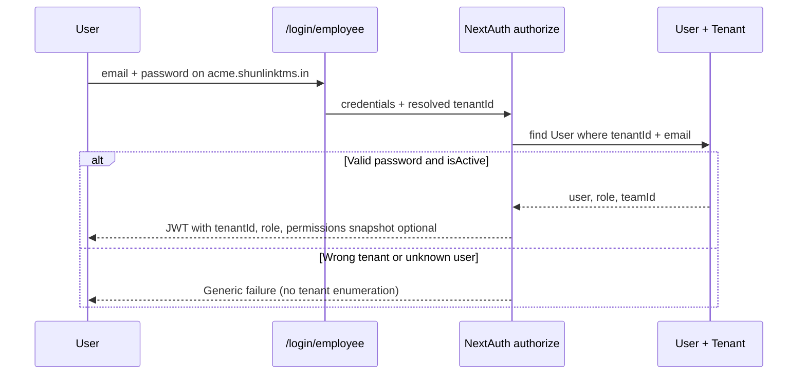

### 5.4 Post-login routing

Reuse existing `auth-home.ts` / `portal-access.ts` logic **inside** the tenant host:

| Role | Destination |
|------|-------------|
| Internal roles | `/(dashboard)/` |
| `CLIENT` | `/portal/client` (after onboarding gate) |
| `VENDOR` | `/portal/vendor` |
| `DRIVER` | `/driver` |

Onboarding gates (`PENDING`, `SUBMITTED`, `APPROVED`) remain per client/vendor **within the tenant**.

### 5.5 Platform admin authentication

- Separate provider or same NextAuth with `loginRealm: platform`.
- Users stored in `PlatformUser` (not `User` with a fake tenant).
- MFA recommended for all platform accounts.
- Session TTL shorter than tenant sessions (e.g. 8h vs 7d).

### 5.6 Support impersonation (audited)

Extends today’s `PortalAccessSession` pattern:

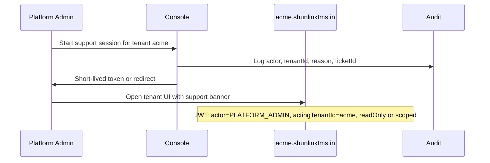

Rules:

- Banner visible: “Shunlink support — read only” (or write if break-glass policy).
- All actions write to audit with `actorType: PLATFORM`.
- Auto-expire (e.g. 1 hour).

### 5.7 Service and machine authentication

| Use case | Mechanism |
|----------|-----------|
| Cron (`/api/cron/*`) | Shared secret header + optional per-tenant job iteration |
| Payment webhooks | Provider signature; map to `tenantId` via metadata |
| WhatsApp webhooks | Phone number ID → `TenantIntegration` |
| Mobile driver app | Tenant code or subdomain in app config + same OTP flow |
| Future **API add-on** | Per-tenant API keys (`TenantApiKey`) scoped to entitlements |

### 5.8 Account lifecycle

| Event | Behavior |
|-------|----------|
| Tenant trial ends | `TRIAL` → `PAST_DUE` → read-only → `SUSPENDED` |
| User deactivated | `isActive=false`; invalidate sessions on next request |
| Password reset | Tenant-scoped reset links on tenant host |
| Tenant deleted | Soft-delete + retention window; purge storage prefix after policy |

---

## 6. Authorization

Authorization answers: **what may this authenticated identity do?**

SaaS uses **two gates** in order:

1. **Entitlement** — does the tenant’s subscription include this module? (commercial)
2. **Permission** — does this user’s role allow this action? (RBAC)

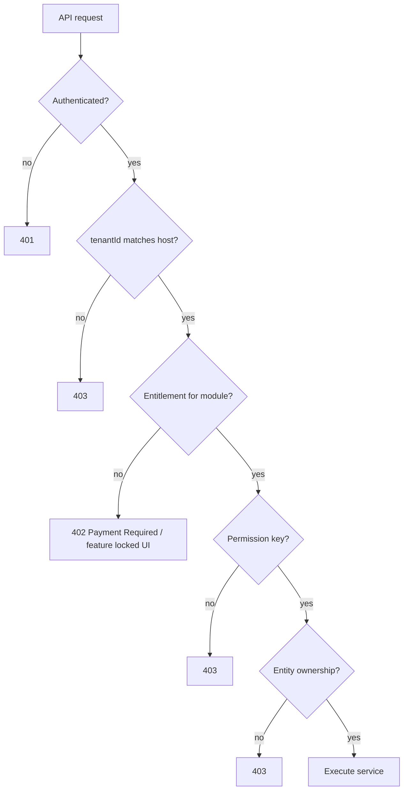

### 6.1 RBAC (tenant) — existing model

- Permission keys: `src/lib/permissions.ts` (`indent.view`, `accounting.journal.post`, …).
- Resolution: `permission.service.ts` — role defaults + `UserPermission` overrides + **Access Role bundles** (add-on `advanced_rbac`).
- Navigation: `nav-permissions.ts` hides items without permission.

**SaaS extension:** each nav item also declares optional `entitlement: 'accounting'` so finance modules disappear when not purchased.

### 6.2 Portal authorization (existing)

| Role | Scope |
|------|--------|
| `CLIENT` | Rows where `clientId` = session client |
| `VENDOR` | Rows where `vendorId` = session vendor |
| `DRIVER` | Current indent/trip for `driverId` |
| Middleware API allowlist | `src/middleware.ts` — keep; all queries still filter `tenantId` |

Never accept `clientId` / `vendorId` from the body without matching session.

### 6.3 Platform authorization

| Action | Who |
|--------|-----|
| Create / suspend tenant | `PLATFORM_ADMIN`, `PLATFORM_BILLING` |
| Toggle add-on | `PLATFORM_ADMIN`, `PLATFORM_SUCCESS` |
| View tenant usage metrics | `PLATFORM_ADMIN`, `PLATFORM_SUPPORT` (aggregated) |
| Support impersonation | `PLATFORM_SUPPORT` with ticket + audit |
| Change global plan pricing | `PLATFORM_SUPER` only |

Platform permissions are a **separate** enum from tenant `PERMISSION_KEYS`.

### 6.4 Entitlement vs permission examples

| Action | Entitlement | Permission |
|--------|-------------|------------|
| Post journal entry | `accounting` | `accounting.journal.post` |
| Send WhatsApp indent release | `whatsapp` | `indent.release` |
| Use access role bundles | `advanced_rbac` | `roles.manage` |
| Live map on trip | `live_tracking_maps` | `tracking.view` |
| Create indent | `core` (base plan) | `indent.create` |

### 6.5 Data-level authorization

Internal staff: permission + `tenantId` filter.

Portals: permission + `tenantId` + entity id filter.

Platform: default **deny**; explicit read APIs for support dashboards only.

---

## 7. Entitlements, plans, and add-ons

### 7.1 Conceptual tables

| Table | Purpose |
|-------|---------|
| `Plan` | Starter / Growth / Enterprise template |
| `PlanEntitlement` | Default limits and feature flags per plan |
| `TenantSubscription` | Active plan, status, billing period, provider ids |
| `AddonProduct` | Sellable SKU (`accounting`, `whatsapp`, …) |
| `TenantAddon` | Enabled add-on for tenant; `source: BILLING \| MANUAL` |
| `UsageMeter` | Trips/month, storage bytes, verification calls |
| `TenantIntegration` | Encrypted BYOK credentials per tenant |

### 7.2 Subscription states

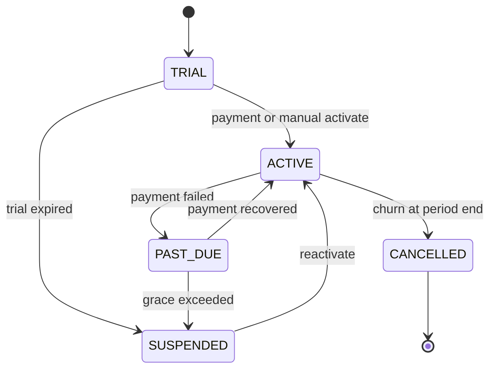

| Status | Tenant experience |
|--------|-------------------|
| `TRIAL` | Full or limited plan; banner with days left |
| `ACTIVE` | Normal |
| `PAST_DUE` | Warning; optional read-only |
| `SUSPENDED` | Login blocked except billing contact; data retained |
| `CANCELLED` | Export window then archive |

### 7.3 Enabling an add-on (platform workflow)

See [§8.4](#84-enable-add-on-manual-or-billing).

---

## 8. Platform workflows

### 8.1 Provision new tenant (manual — phase 1)

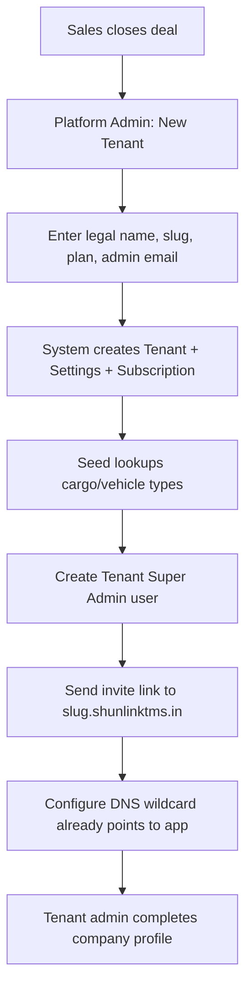

**Outputs:** `tenantId`, subdomain live, first invoice or trial timer started.

### 8.2 Self-serve signup (phase 2)

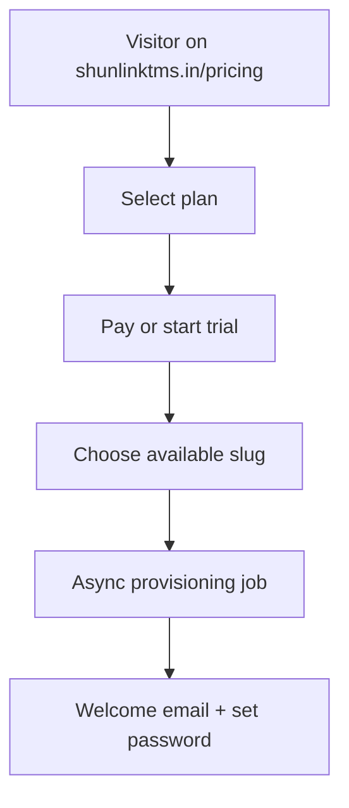

Provisioning job must be **idempotent** (retry-safe).

### 8.3 Billing renewal and dunning

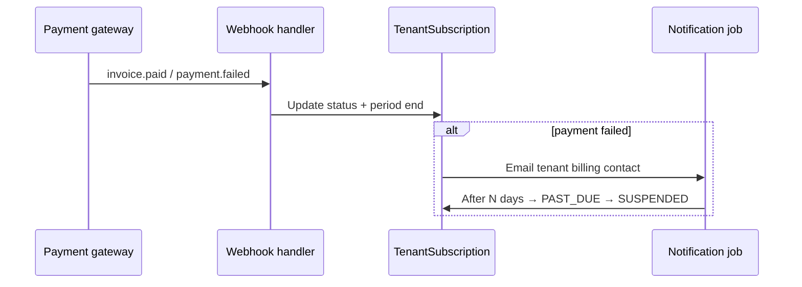

### 8.4 Enable add-on (manual or billing)

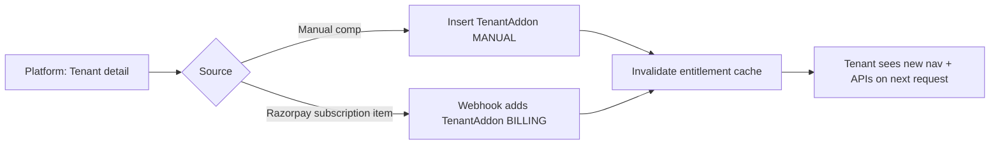

### 8.5 Custom domain attach (add-on)

1. Tenant enters `tms.acme.com` in settings (locked without entitlement).
2. Platform shows CNAME target.
3. Tenant configures DNS; ACME issues certificate.
4. `TenantDomain.verifiedAt` set; middleware resolves tenant from custom host.

---

## 9. Tenant TMS workflows

These mirror the current TMS business architecture; all steps are **inside one `tenantId`**.

### 9.1 Core commercial pipeline

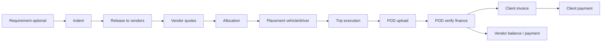

### 9.2 Advance and trip start (guard)

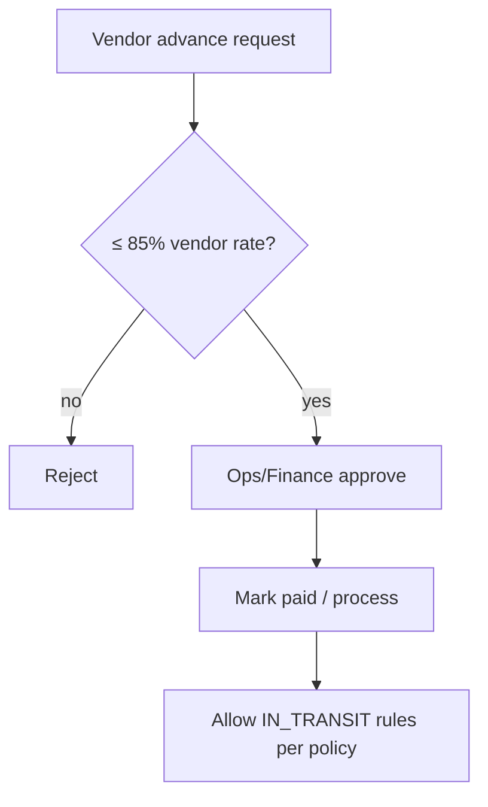

### 9.3 Client onboarding

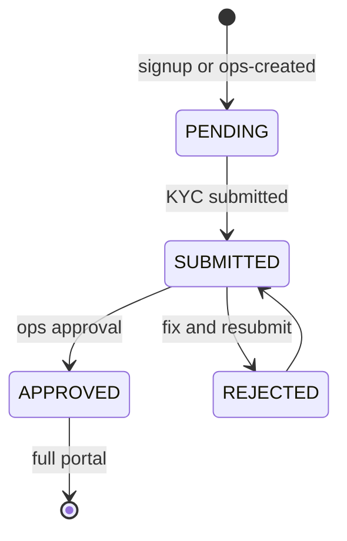

Optional **onboarding assist** add-on: `onboarding-requests` queue for Shunlink-style assisted flow **operated by tenant staff** (or platform services if you sell professional services separately).

### 9.4 Vendor quote channels (mutually exclusive per indent)

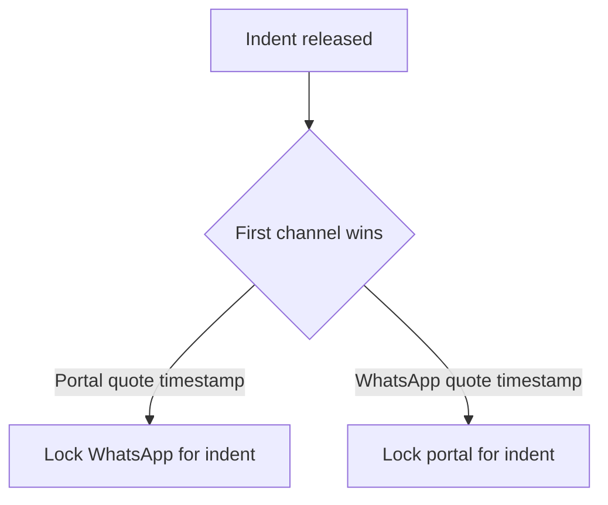

WhatsApp add-on required for WhatsApp path.

---

## 10. User flows by persona

### 10.1 Platform Admin — morning check

1. Open `console.shunlinktms.in` → platform login (MFA).
2. Dashboard: MRR, trials ending, `PAST_DUE` tenants, error rate per tenant.
3. Open tenant `acme` → view usage (trips, storage, seats).
4. Enable add-on `accounting` (manual pilot) → save.
5. Optional: start support session → redirected to `acme.shunlinktms.in` with banner.

### 10.2 Tenant Super Admin — first day

1. Receive invite → `https://acme.shunlinktms.in/login/employee`.
2. Set password → land on dashboard (empty).
3. Settings: company GSTIN, logo, indent/LR prefixes, notification emails.
4. Users: invite Operations, Finance, Sales.
5. Partners: create first client and vendor (or open self-signup if enabled).
6. Integrations (if entitled): paste WhatsApp / maps keys.

### 10.3 Operations — indent to trip

1. Create indent (phone/email demand) or convert requirement.
2. Release to cities/zones → vendors notified (email / WhatsApp if entitled).
3. Compare quotes → allocate vendor.
4. Placement queue → assign vehicle and driver.
5. Monitor trip tracking (maps add-on for rich map).
6. POD uploaded → finance queue.

### 10.4 Finance — POD to cash

1. POD queue → verify POD.
2. Invoice generated → receivables.
3. Record client payment.
4. Process vendor advance / balance per workflow.
5. If `accounting` add-on: journal entries, period close, reconciliation imports.

### 10.5 Client portal

1. `acme.shunlinktms.in/login/client`.
2. Submit requirement (rare) or view shipments.
3. Track shipment (add-on: detail page with map and milestones).
4. View and pay invoices (gateway add-on future).

### 10.6 Vendor portal

1. Login → action list (open quotes, placement tasks, POD due).
2. Submit quote on released indent.
3. Assign driver/vehicle → trip starts.
4. Request advance → upload POD.
5. Payments page shows balance breakdown.

### 10.7 Driver

1. DL + OTP login on tenant host or mobile app configured with tenant.
2. Post GPS pings → `TrackingPing`.
3. Capture POD photos.

---

## 11. Data and isolation

### 11.1 Rules

| Rule | Implementation |
|------|----------------|
| Every business row has `tenantId` | Schema + migrations |
| Queries always filter `tenantId` from session | Prisma extension or wrapper |
| Document numbers unique per tenant | `@@unique([tenantId, indentNumber])` |
| Files isolated | Object key prefix `{tenantId}/` |
| Sequences | `IdSequence` per tenant + prefix |
| Audit logs | Include `tenantId`; platform actions tagged |

### 11.2 Schema layers (from DATABASE_SCHEMA.md)

```
PLATFORM:     Tenant, TenantSettings, TenantDomain, TenantSubscription, TenantAddon, …
AUTH/RBAC:    User (tenantId), Permission, RolePermission, AccessRole, …
PRIMITIVES:   Address, StoredFile, OnboardingCase, …
MASTERS:      Client, Vendor, Driver, Vehicle, …
COMMERCIAL:   Requirement, Indent cluster, Trip, Invoice, Payment, …
```

### 11.3 Migration from current single-tenant TMS

See [MIGRATION.md](./MIGRATION.md):

- **Greenfield SaaS DB** + ETL from v1, default tenant `shunlink`.
- Not a simple `ALTER TABLE ADD tenantId` on production v1 without backfill script.

---

## 12. Infrastructure and operations

### 12.1 Production checklist

| Item | Recommendation |
|------|----------------|
| App | Horizontal scale; health `/api/health` |
| DB | PostgreSQL 16; PgBouncer transaction mode |
| Cache / queue | Redis; BullMQ for email and async jobs |
| Storage | S3-compatible; **no** shared local `public/uploads` in prod |
| TLS | Wildcard cert for `*.shunlinktms.in` |
| Secrets | Platform env + `TenantIntegration` vault |
| Backups | Daily PG backup; per-tenant export for Enterprise |
| Observability | Structured logs with `tenantId`; metrics per tenant |

### 12.2 Background jobs

Every job payload:

```json
{
  "tenantId": "cuid...",
  "type": "sla-escalate",
  "runId": "..."
}
```

Cron routes either:

- Loop `SELECT id FROM Tenant WHERE status = 'ACTIVE'`, or
- Shard work across workers by tenant id hash.

### 12.3 Noisy neighbor controls

- Rate limit per `tenantId` (Redis).
- Fair queue scheduling for email.
- Hard caps from plan (`maxTripsPerMonth`).

---

## 13. Security and compliance

| Topic | Approach |
|-------|----------|
| **Tenant isolation** | Mandatory `tenantId` filter; integration tests for IDOR |
| **Platform access** | Separate auth; MFA; least privilege |
| **Support impersonation** | Time-boxed; audited; visible banner |
| **Data residency** | India region DB + object storage for Indian customers |
| **DPDP** | Tenant is data controller for their clients/vendors; Shunlink is processor — DPA in contract |
| **PCI** | Use gateway hosted checkout; no card data in TMS DB |
| **Webhook security** | Verify signatures; constant-time secrets |

---

## 14. Implementation roadmap

| Phase | Focus | Exit criteria |
|-------|--------|---------------|
| **0** | Finalize SaaS schema + `tenantId` strategy | Prisma migrated; seed tenant `shunlink` |
| **1** | Host resolution + session `tenantId` + query wrapper | Cross-tenant tests pass |
| **2** | Platform console: CRUD tenant, manual provision | New slug works end-to-end |
| **3** | Entitlements + nav/API gates | Add-on toggles hide modules |
| **4** | Billing (Razorpay) + webhooks | Trial → paid → suspend automated |
| **5** | S3 storage + per-tenant prefixes | No local uploads in prod |
| **6** | Custom domain + branding | Verified custom host |
| **7** | Self-serve signup | Paid tenant without manual steps |
| **8** | Enterprise isolation option | Dedicated DB playbook |

Application feature work (maps, client tracking, AI) continues on **tenant** codebase behind entitlements.

---

## 15. Appendix: base vs add-on matrix

### 15.1 Base package — **TMS Core**

Included for all paid plans (limits vary by tier):

| Module | Features |
|--------|----------|
| Dashboard | KPIs, basic work visibility |
| Operations | Requirements, indents, placement, trips |
| Partners | Clients, vendors, vehicles, drivers |
| Onboarding | Standard KYC approval queue |
| Quoting | Portal quotes, allocation, release |
| Execution | Trip lifecycle, dual-image POD |
| Advances | Request, approve, cap validation |
| Finance lite | Invoices, mark paid, vendor payments, POD queue, payables/receivables summary |
| Portals | Client, vendor, driver web |
| Admin | Users, teams, default role templates |
| Audit | Employee activity (retention by plan) |
| Notifications | In-app; basic email |

**Typical plan limits (example)**

| Limit | Starter | Growth |
|-------|---------|--------|
| Staff users | 5 | 25 |
| Trips / month | 200 | 2,000 |
| Storage | 10 GB | 100 GB |
| Audit retention | 90 days | 1 year |

### 15.2 Add-on catalog

| SKU | Customer value | Maps to permissions / code |
|-----|----------------|----------------------------|
| `accounting` | Full GL, periods, recon | `accounting.*` |
| `payments_gateway` | Outbound payments automation | Outbound payment APIs |
| `financial_notes` | Debit/credit notes | `financial_note.*` |
| `advanced_rbac` | Access role bundles | `/access-roles` |
| `whatsapp` | Notifications and releases | `notify.ts`, webhooks |
| `whatsapp_quotes` | Token quote links | `/quote/[token]` |
| `bidding` | External bidding integration | `bidding-integration` |
| `live_tracking_maps` | Maps, route, ETA | `maps/config`, `trip-route`, `trip-eta` |
| `cell_tracking` | Feature-phone towers | `tracking/ingest` |
| `sla_automation` | SLA + digest emails | `sla-escalation`, email worker |
| `compliance_verify` | GST/DL/RC checks | Surepass integrations (metered) |
| `eway_bill` | E-way bill | e-way UI + APIs |
| `analytics_pro` | Lane rates, exports | Reports services |
| `bulk_advance` | Bulk vendor advance | Bulk advance routes |
| `client_tracking_portal` | Rich client shipment page | Portal trip detail |
| `onboarding_assist` | Assisted onboarding pipeline | Onboarding requests |
| `white_label_domain` | Custom domain + branding | `TenantDomain` |
| `api_access` | REST/webhooks for ERP | New platform APIs |
| `ai_ops` | Copilots, smart compare | AUTOMATION_AND_AI roadmap |
| `enterprise_isolation` | Dedicated DB / SLA | Infrastructure SKU |

### 15.3 Example bundles

| Plan | Includes | Add-ons |
|------|----------|---------|
| **Starter** | TMS Core | Purchase any add-on à la carte |
| **Growth** | Core + higher limits | 1–2 add-ons discounted |
| **Enterprise** | Core + accounting + SLA + custom domain | Custom contract, dedicated support |

---

## Document history

| Version | Date | Notes |
|---------|------|-------|
| 1.0 | Oct 2026 | Initial SaaS platform guide: architecture, auth, workflows, entitlements |

---

*For schema field-level detail, continue with [DATABASE_SCHEMA.md](./DATABASE_SCHEMA.md). For where code lives today, use [DEVELOPER_CODEMAP.md](./DEVELOPER_CODEMAP.md).*
