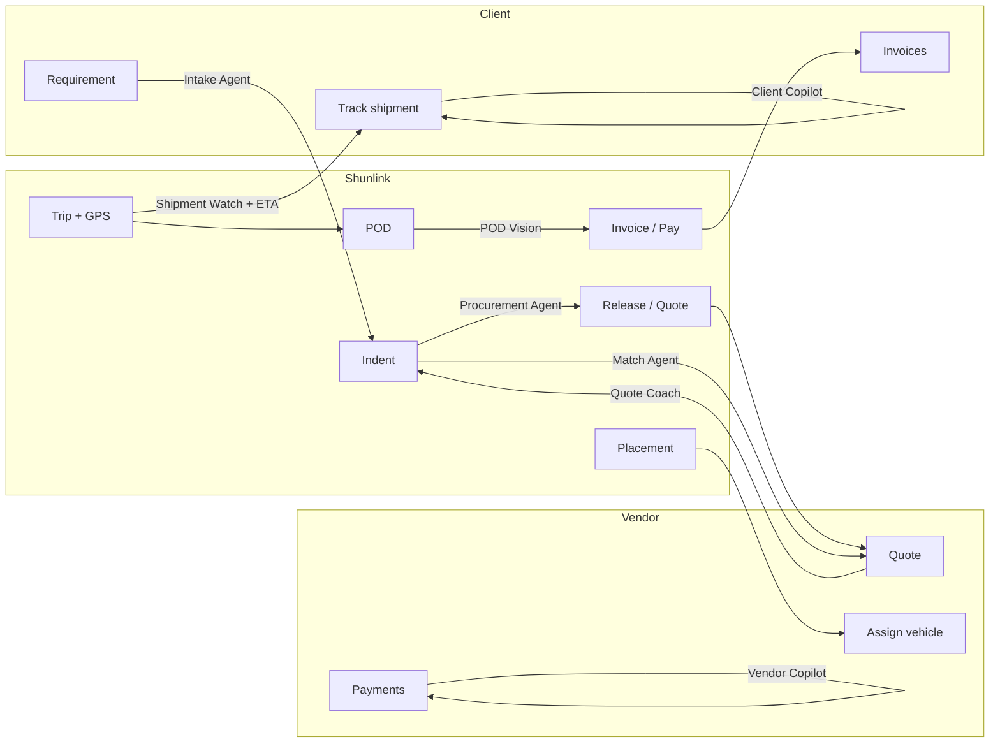

# Shunlink — AI & Agent Implementation Plan

**Version:** 1.0 · **Product:** Shunlink 4PL TMS  
**Scope:** Where to integrate AI and autonomous agents across **client**, **vendor**, **driver**, and **internal** flows—grounded in the current codebase.

Companion: [PLATFORM_EASE_PLAN.md](./PLATFORM_EASE_PLAN.md) (UX priorities) · [AI_AUTOMATION_ROADMAP.md](./AI_AUTOMATION_ROADMAP.md) (market/competitor depth).

---

## 1. Objectives

| Goal | How AI helps |
|------|----------------|
| **Client trust** | Live tracking + ETA + proactive delay alerts + self-serve Q&A |
| **Vendor productivity** | Right loads first, smarter quotes, fewer POD/payment surprises |
| **Team scale** | Priority queues, award suggestions, doc extraction—not replacing approvals |
| **Investor story** | Named agents on real workflows with audit trail and human gates on money |

**Principle:** Agents call **existing domain services** (`src/lib/services/*`). No shadow databases. No auto-payout or auto-award in v1.

---

## 2. End-to-end flow — where AI plugs in



| Lifecycle stage | Primary users | AI integration type |
|-----------------|---------------|---------------------|
| Requirement / indent create | Client, sales, ops | NLP intake, lane rate hint |
| Release & quoting | Vendor, ops | Match ranking, quote coach, procurement assist |
| Placement | Vendor, ops | Checklist assist, placement nudge |
| In transit | Client, ops | **Shipment Watch**, **ETA Predictor**, tracking UI |
| POD & delivery | Vendor, finance | POD Vision, delay root-cause (rules) |
| Billing & pay | Client, vendor, finance | Copilots, invoice explain, payment ETA |
| Onboarding | Client, vendor, ops | Doc classify, KYC assist |

---

## 3. Core agents (must-have)

### 3.1 Shipment Watch Agent

**For:** Client (primary), ops (secondary)  
**Job:** Monitor active trips and detect exceptions before the client calls.

| Item | Detail |
|------|--------|
| **Triggers** | Cron every 15–30 min (`/api/cron/shipment-watch`); optional hook after `addTrackingPing` |
| **Inputs** | `TrackingPing`, trip status, `dispatchedAt`, lane (origin/destination), last ping age |
| **Logic (v1)** | Rules: no ping &gt; 4h while `IN_TRANSIT`; geofence stall &gt; 2h; off-corridor &gt; X km (optional) |
| **Logic (v2)** | ML on historical stop patterns (Freight Tiger–style avoidable vs unavoidable stops) |
| **Outputs** | Client notification (`notify.ts`); timeline event on tracking page; `ImportantEvent` for ops |
| **UI** | `/portal/client/trips/[id]` — banner: “On track” / “Possible delay” |
| **Autonomy** | **L2** notify only; never changes trip status |
| **Code hooks** | `tracking.service.ts`, `important-event.service.ts`, `sla-notify.service.ts` |

---

### 3.2 ETA Predictor Agent

**For:** Client (tracking page), ops (trip detail)  
**Job:** Show an **expected delivery window**, updated as pings arrive.

| Item | Detail |
|------|--------|
| **Triggers** | Trip enters `DISPATCHED` / `IN_TRANSIT`; each new ping (debounced) |
| **Inputs** | Lane history (`Trip` aggregates), distance (geocode/load vs unload), elapsed time, recent speed |
| **Logic (v1)** | Median TAT per `routeFrom→routeTo` + vehicle type; adjust by % journey completed |
| **Logic (v2)** | Regression / GBM with time-of-day, month, client plant |
| **Outputs** | `etaWindowStart`, `etaWindowEnd`, confidence label; store in Redis or `Trip` JSON meta |
| **UI** | Client tracking page; optional WhatsApp when ETA slips &gt; N hours |
| **Autonomy** | **L1** display only |
| **Code hooks** | New `src/lib/ai/agents/eta-predictor.ts`; read via `queries.getClientTripDetail` |

---

### 3.3 Client Copilot Agent

**For:** Client portal users  
**Job:** Answer questions and guide actions using **only that client’s data**.

| Item | Detail |
|------|--------|
| **Triggers** | User opens chat on `/portal/client/*` |
| **Tools (server)** | `getClientTrips`, trip tracking summary, `getClientInvoices`, `getClientRequirements`, shipment status |
| **Example intents** | “Where is LR 1234?”, “Unpaid invoices?”, “Raise requirement for Pune–Mumbai” → link to form |
| **LLM** | Tool-calling model; system prompt: no hallucinated amounts; cite trip/invoice IDs |
| **UI** | Floating assistant on client shell (`client-portal-shell.tsx`) |
| **API** | `POST /api/portal/client/copilot` (stream optional) |
| **Autonomy** | **L1** read-only in v1; **L2** draft requirement (user submits) in v2 |
| **Security** | `clientId` from session only; redact other parties’ phone/bank in answers |

---

### 3.4 Vendor Copilot Agent

**For:** Vendor portal users  
**Job:** Explain indents, payments, POD rejections, advance status; deep-link to actions.

| Item | Detail |
|------|--------|
| **Triggers** | Chat on `/portal/vendor/*` |
| **Tools** | Open indents, trip detail, `getVendorPayments`, advance request state, POD status |
| **Example intents** | “Why is balance pending for trip X?”, “Open indents on Delhi lane”, “POD rejected reason” |
| **UI** | Vendor shell (`vendor-portal-shell.tsx`) |
| **API** | `POST /api/portal/vendor/copilot` |
| **Autonomy** | **L1** read-only v1; **L2** pre-fill quote (user submits) v2 |
| **Security** | `vendorId` from session only |

---

## 4. Extended agents & features (recommended)

### 4.1 Client-facing

| Agent / feature | What it does | Integrate at | Phase |
|-----------------|--------------|--------------|-------|
| **Tracking experience (non-LLM)** | India Post–style timeline + map | `/portal/client/trips/[id]`, portal tracking API | P0 |
| **Milestone notifier** | WA/email on dispatch, deliver, invoice | Trip status transitions in `trip-status-actions` / services | P0 |
| **Invoice explainer** | Plain-language breakdown of charges | `/portal/client/invoices/[id]` + copilot tool | P1 |
| **Requirement intake** | Paste email → draft requirement | `/portal/client/requirements/new`, LLM → Zod | P2 |
| **Demand hint** | “You usually book 8 trucks this week” | Client overview analytics | P2 |

### 4.2 Vendor-facing

| Agent / feature | What it does | Integrate at | Phase |
|-----------------|--------------|--------------|-------|
| **Indent Match Agent** | Rank open indents (zone, type, lane, rating) | `/portal/vendor/indents`, `scoreMatch` + zones | P0 |
| **Quote Coach Agent** | Suggest rate band vs lane history | Quote form on indent | P0 |
| **Placement Nudge Agent** | Remind before placement SLA | `SlaTask` + assignment pages | P1 |
| **POD Vision Agent** | Blur/dark/missing side; OCR LR match | `PodUpload`, `pod.service` | P1 |
| **Payment ETA Agent** | “Balance likely after POD verified + N days” | `/portal/vendor/payments` | P1 |
| **Bulk advance advisor** | Which trips to include in bulk request | `/portal/vendor/indents/.../bulk-advance` | P2 |

### 4.3 Internal (ops / finance / sales)

| Agent / feature | What it does | Integrate at | Phase |
|-----------------|--------------|--------------|-------|
| **Ops Priority Agent** | Sort work-queue + SLA + events | Dashboard `/`, `work-queues.service` | P0 |
| **Procurement Assist Agent** | Suggest vendor award + margin | `/indents/[id]` quotes panel | P0 |
| **Release suggester** | Cities/zones for release | Release dialog, `release.service` | P0 |
| **Requirement matcher** | Already “Suggested vendors” — enrich | `/requirements/[id]` | P0 |
| **POD fast-lane** | Score POD for auto-queue to human | `/pods`, `pod.service` | P1 |
| **Advance anomaly** | Flag unusual advance vs trip rate | `trip-advance.service` | P1 |
| **Invoice task assist** | Pre-fill invoice from trip charges | `invoice-task.service`, `/invoices/new` | P1 |
| **Onboarding doc agent** | Classify RC/GST/PAN; pre-fill | `/onboarding`, portal onboard APIs | P2 |
| **Reconciliation assist** | Suggest bank line ↔ payment match | Accounting reconciliation UI | P2 |
| **Bidding handoff analyst** | Summarize award vs TMS indent | `bidding-integration.service` | P2 |

### 4.4 Driver (future-friendly)

| Agent / feature | What it does | Integrate at | Phase |
|-----------------|--------------|--------------|-------|
| **GPS nudge** | Remind driver to open app / share location | `/driver`, stale ping detection | P1 |
| **POD capture coach** | On-device “hold steady / more light” | `camera-capture.tsx` | P1 |
| **Voice status (WA)** | Transcribe voice note → structured status | WhatsApp webhook extension | P3 |

---

## 5. Screen & API integration map

| Surface | Route / API | Agents & AI features |
|---------|-------------|----------------------|
| **Client overview** | `/portal/client` | Copilot; attention CTA; active shipment deep link |
| **Client shipments** | `/portal/client/trips`, `/trips/[id]` | Tracking UI, **ETA**, **Shipment Watch** banner |
| **Client requirements** | `/portal/client/requirements/*` | Intake agent (draft); copilot link |
| **Client invoices** | `/portal/client/invoices/*` | Invoice explainer; copilot |
| **Vendor overview** | `/portal/vendor` | Action list; copilot; indent count |
| **Vendor indents** | `/portal/vendor/indents` | **Indent Match** ranking |
| **Vendor trips** | `/portal/vendor/trips/[id]` | POD Vision; copilot |
| **Vendor payments** | `/portal/vendor/payments` | Payment ETA; copilot |
| **Staff dashboard** | `/` | **Ops Priority** |
| **Indent detail** | `/indents/[id]` | Procurement assist; release suggester; live tracking |
| **Requirement** | `/requirements/[id]` | Matcher enrichment |
| **Placement** | `/placement` | Nudge triggers (vendor SLA) |
| **POD queue** | `/pods` | POD Vision scores |
| **Trips** | `/trips/[id]` | ETA; Shipment Watch (staff view) |
| **Onboarding** | `/onboarding`, `/onboarding-requests` | Doc agent |
| **Cron** | `/api/cron/sla-escalate`, new `shipment-watch` | Watch + ETA batch refresh |

---

## 6. Technical architecture

```text
┌─────────────────────────────────────────────────────────────┐
│  UI: Client / Vendor shells, tracking page, chat widget    │
└───────────────────────────┬─────────────────────────────────┘
                            │
┌───────────────────────────▼─────────────────────────────────┐
│  API: /api/portal/{client|vendor}/copilot                     │
│       /api/portal/client/trips/[id]/tracking                  │
│       /api/cron/shipment-watch                                │
└───────────────────────────┬─────────────────────────────────┘
                            │
┌───────────────────────────▼─────────────────────────────────┐
│  src/lib/ai/                                                 │
│    provider.ts      — OpenAI / Azure OpenAI (env)           │
│    redact.ts        — PII strip for prompts                   │
│    orchestrator.ts  — route message → agent                   │
│    agents/                                                    │
│      shipment-watch.ts   (rules + optional ML)                │
│      eta-predictor.ts    (stats → model)                      │
│      copilot-client.ts   (tools)                              │
│      copilot-vendor.ts   (tools)                              │
│      indent-match.ts     (scoring)                            │
│      quote-coach.ts                                         │
│      procurement-assist.ts                                  │
│    tools/           — thin wrappers over services/queries     │
└───────────────────────────┬─────────────────────────────────┘
                            │
┌───────────────────────────▼─────────────────────────────────┐
│  Existing: services/*.ts, queries.ts, notify.ts, audit.ts     │
│  Data: Trip, TrackingPing, VendorQuote, SlaTask, …           │
└─────────────────────────────────────────────────────────────┘
```

### New permissions

| Key | Who |
|-----|-----|
| `ai.copilot.use` | CLIENT, VENDOR portal roles |
| `ai.insights.view` | Staff (ETA/watch on dashboard) |
| `ai.admin.configure` | ADMIN (model flags, thresholds) |

### Audit events (examples)

`ai.shipment_watch.alert`, `ai.eta.updated`, `ai.copilot.query`, `ai.procurement.suggestion_shown`, `ai.quote_coach.shown`

---

## 7. Autonomy levels (governance)

| Level | Meaning | Shunlink default |
|-------|---------|------------------|
| **L0** | Analytics only | Reports, lane rates |
| **L1** | Recommend / display | ETA, match order, quote band, procurement suggestion |
| **L2** | Act with human confirm | WA alert, draft requirement, draft quote |
| **L3** | Auto within policy | Not in v1 (e.g. auto-release to top 5 vendors) |

**Never L3 without explicit policy:** `indent.allocate`, `payment.approve`, `payment.process`, `pod.approve`.

---

## 8. Implementation phases

### Phase P0 — Foundation (4–6 weeks)

| Deliverable | Agents / features |
|-------------|-------------------|
| Client tracking page + scoped tracking API | Tracking UI (feeds Watch + ETA) |
| **Shipment Watch** v1 (rules + cron) | Core client agent |
| **ETA Predictor** v1 (lane median) | Core client agent |
| **Indent Match** + **Quote Coach** | Vendor AI (no LLM) |
| **Ops Priority** + **Procurement Assist** | Staff AI (no LLM) |
| Env: `AI_ENABLED`, provider keys optional for P0 |

### Phase P1 — Copilots & vision (4–6 weeks)

| Deliverable | Agents / features |
|-------------|-------------------|
| **Client Copilot** + **Vendor Copilot** | LLM + tools |
| **POD Vision** v1 | Vendor + finance |
| **Placement Nudge** | Vendor |
| **Payment ETA** | Vendor |
| Milestone WA with track links | Client |

### Phase P2 — Intake & onboarding (6+ weeks)

| Deliverable | Agents / features |
|-------------|-------------------|
| **Requirement intake** | Client + ops |
| **Onboarding doc agent** | Ops |
| **Invoice / reconciliation assist** | Finance |
| Shipment Watch v2 (ML stops) | Client + ops |

### Phase P3 — Advanced

Public track link, voice/WhatsApp agents, bidding analyst, driver GPS nudge at scale.

---

## 9. Data & dependencies

| Agent | Minimum data needed |
|-------|---------------------|
| ETA Predictor | ≥10 completed trips per lane (fallback: India avg TAT + manual buffer) |
| Shipment Watch | `TrackingPing` on trip (driver GPS); cell mode lower accuracy |
| Quote Coach | Historical `vendorRate` / quotes on lane |
| Copilots | Stable portal read APIs per tool |
| POD Vision | Labeled POD accept/reject history (optional for ML) |

**Driver tracking dependency:** Client experience requires vendors/drivers posting pings (`/api/trips/[id]/tracking`, driver app). Shipment Watch should surface “Location pending” when no pings—not a false ETA.

---

## 10. Security checklist

- [ ] Portal copilot tools ignore client-supplied `clientId` / `vendorId`
- [ ] Rate limit copilot and cron endpoints
- [ ] Redact PAN, bank, full phone in LLM prompts
- [ ] Log agent actions in `AuditLog`; no document images in logs
- [ ] India-region or enterprise AI contract for production
- [ ] Feature flags per agent (`AI_SHIPMENT_WATCH`, `AI_COPILOT_CLIENT`, …)

---

## 11. Success metrics

| Agent | KPI |
|-------|-----|
| Shipment Watch | % active trips with proactive alert before client calls ops |
| ETA Predictor | Median error (hours) vs actual `deliveredAt` |
| Client Copilot | % queries resolved without ticket; CSAT |
| Vendor Copilot | Reduction payment-status support calls |
| Indent Match | Quote rate per release; time-to-first-quote |
| Procurement Assist | Time indent released → allocated |

---

## 12. Summary — agent catalog

| # | Agent | User | LLM? | Phase |
|---|-------|------|-------|-------|
| 1 | **Shipment Watch** | Client, ops | Optional v2 | P0 |
| 2 | **ETA Predictor** | Client, ops | No (v1) | P0 |
| 3 | **Client Copilot** | Client | Yes | P1 |
| 4 | **Vendor Copilot** | Vendor | Yes | P1 |
| 5 | Indent Match | Vendor | No | P0 |
| 6 | Quote Coach | Vendor | No | P0 |
| 7 | Procurement Assist | Ops | Optional | P0 |
| 8 | Ops Priority | Ops, finance | No | P0 |
| 9 | Placement Nudge | Vendor | No | P1 |
| 10 | POD Vision | Vendor, finance | CV/OCR | P1 |
| 11 | Payment ETA | Vendor | No | P1 |
| 12 | Milestone notifier | Client | No | P0 |
| 13 | Requirement intake | Client, ops | Yes | P2 |
| 14 | Onboarding doc | Ops | Yes | P2 |
| 15 | Invoice / recon assist | Finance | Yes | P2 |

---

*This document is the single source of truth for **what to build** and **where it connects** in Shunlink. Implementation tickets should reference agent ID, surface route, and phase from this plan.*
